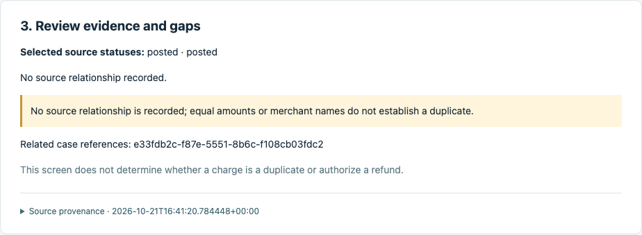
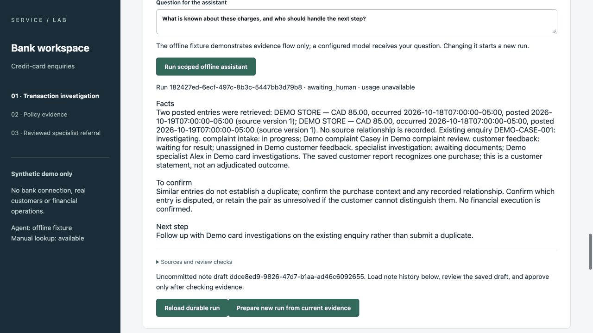

# Service Agent Portfolio

[](https://github.com/xc8609/service-agent-portfolio/actions/workflows/portfolio-checks.yml)

**From customer-service problems to working, human-reviewed AI workflows.**

Service Agent Portfolio is a lightweight, open-source application portfolio that
connects **business analysis, specification-driven development and Agent engineering**.
It starts with a simulated banking service desk and demonstrates how requirements,
process decisions and acceptance criteria become working software and test evidence.

## Why this project

Customer-service representatives often need to navigate several screens to find
customer information, work within different access permissions and learn which
handling rules apply. This project brings permitted information, relevant rules and
accountable follow-up into one workflow.

The first case is **“I bought once — why do I see two credit-card charges?”**
The representative inspects transactions and existing cases, records what the
customer recognizes, checks handling rules, and submits a reviewed specialist enquiry
when needed. The Agent helps assemble evidence and draft the next step; authorized
staff retain responsibility for decisions and customer communication.

**The intended value:** less information-search effort, more consistent handling and
clearer handoffs. These are hypotheses to test against the manual workflow; measured
cost savings and production outcomes are not yet claimed.

**Start here:** the one-page [case study](docs/case-study.md) — problem, approach,
decisions and what the evidence does and does not show.

| Evidence, not a guess | Rules before advice | A draft, never a decision |
|---|---|---|
|  |  |  |

## What you can explore

- **Business analysis:** problem definition, current/target processes, permissions,
  exceptions, story cards, Sprint planning and traceable acceptance criteria.
- **Working service workflow:** scoped transaction/rule lookup, reviewed notes and
  referrals, specialist findings, manual feedback and contact/exception handling.
- **Agent engineering:** a bounded evidence assistant, server-selected model API
  adapters, persisted runs, source citations and human approval boundaries.
- **Honest evaluation:** a [frozen pilot](projects/bank-service-assist/evaluation/README.md)
  comparing a decision table with three models on a small synthetic case set.
  Review found gaps in the original safety scorer; versioned regression checks and
  limitations are published alongside the historical pilot.
- **Data and delivery evidence:** reconciled SQL exports, a Tableau workbook,
  automated tests, CI and a reproducible local deployment.
- **Real-data analytics:** [complaint operations analytics](projects/complaint-analytics/README.md)
  on 27,011 public CFPB complaints — SQL profiling, Tableau, findings and a
  frozen-split routing baseline (81.7% team accuracy vs 31.5% majority).

**Stack:** React/TypeScript · FastAPI/Python · PostgreSQL · SQL/Tableau · Docker Compose.

**Current status:** the bank core runs end to end on synthetic data with an offline,
scripted assistant; 38 requirements trace to the tests that verify them. Live models and
real bank integrations are deliberately not qualified. Owner UAT ([pack](docs/uat/README.md)),
Tableau refresh acceptance and a human benefit study remain pending. Voice service and
retail clienteling are later releases.

**Next delivery:** [a focused bank demo and 20 practical checks](projects/bank-service-assist/evaluation/r2/portfolio-scope.md): scoped lookup, useful drafts and staff confirmation. Model answers are explored through [Codex subscription-session simulation](projects/bank-service-assist/evaluation/r2/subscription-simulation.md); the app uses its offline provider. API integration is deferred. Cases and review are AI-assisted, not an independent benchmark.

The first [12-scenario exercise](projects/bank-service-assist/evaluation/r2/subscription-results-20261022.md)
records actual session answers, review findings and fixes to recognition/policy handling.

## Repository map

```text
apps/web/                         React/TypeScript workspace + browser tests
services/api/                     FastAPI, PostgreSQL migrations + API tests
  bank_api/agent/                 Bounded runtime, provider adapters + server selection
  bank_api/integrations/          Offline source-mapping validation
projects/complaint-analytics/     Real public complaint data: SQL, Tableau, results
projects/bank-service-assist/
  docs/                          Business analysis, decisions + Sprint evidence
  specs/<STORY-ID>/               spec, design, tasks, acceptance
  specs/contracts/               Permissions, data model, tool/API schemas
  data/                          Source/terms notes; datasets excluded from Git
  scripts/                       Offline data/specification checks
  sql/ + dashboard/              Operational marts + Tableau workbook candidate
docs/backlog/                     Story catalogue, Sprint forecast + current scope
docs/decisions/ + architecture/   Repository decisions + architecture ADRs
examples/                        Synthetic source mappings + disabled model profiles
.github/workflows/               Offline, API/browser and container CI
```

[Business analysis](projects/bank-service-assist/docs/README.md) ·
[Stories & current delivery](docs/backlog/README.md) ·
[Detailed design](projects/bank-service-assist/specs/README.md) ·
[Architecture & Agent boundary](docs/architecture.md) ·
[Trello](https://trello.com/b/wtNhuN0q/ai-agent)

## Run the demo

Requires Docker Compose. From the repository root:

```bash
python3 scripts/configure_demo.py
docker compose up --build --wait
```

Open **http://127.0.0.1:8000**. No model key is needed. Keep this synthetic demo on
localhost; the persona selector is a local identity simulation, not production sign-in.

[Mac setup without Docker, tests and recovery](services/api/README.md) ·
[Executed evidence and limits](projects/bank-service-assist/docs/sprint-02/implementation/lookup-evidence.md)

## Walk through the core flow

The page follows the case from the first call to the final callback. Each write is a
trusted command that rechecks identity, scope and versions and returns a receipt.

| Step | Where (role) | What it demonstrates |
|---|---|---|
| 1 | Sections 1–3 · *Verified inbound representative* | Search `DEMO STORE`, select both entries, inspect evidence: pending vs posted, and no inferred duplicate |
| 2 | Section 4, rules, related cases | Record what the customer recognizes, kept separate from source facts; cited simulated rules; existing work shown before any new enquiry |
| 3 | Offline assistant, section 5 | A bounded run drafts a cited note; a person edits and approves it, or returns it with a reason |
| 4 | Section 6 | A reviewed specialist enquiry, including an unresolved pair, missing material or a contact gap, with a receipt and the accountable queue |
| 5 | Section 7 · *Demo specialist Alex* | Claim, request material through customer service, publish a finding with a customer-approved explanation and separate private notes |
| 6 | Section 7 · *Feedback representative* | Claim feedback, open a synthetic callback, approve the explanation, verify identity, record the actual outcome. No answer means a retry or lead review, never closure |
| 7 | Section 7, then related cases | Close only after verified feedback and completed work. A customer who later disputes it can call in; the disagreement reopens the case for re-review with history kept |
| 8 | Section 7 · *Complaint intake coordinator* | A requested complaint is delivered by the worker and acknowledged with the complaint unit's reference, independently of the re-review |

## Architecture and extension points

One UI, one API and one workflow database keep the application small and explainable:

```text
React workspace ──► FastAPI trusted commands ──► PostgreSQL workflow store
                      │  identity · scope · versions · receipts · audit · outbox
                      ├─ Bounded Agent runtime (read/draft tools only)
                      │    └─ server-selected model route ─► Responses | Messages | compatible chat
                      └─ Canonical read model ◄── source mapping preview (export / API shapes)
```

- **Model APIs:** a deployment profile selects the protocol, endpoint allowlist and
  credential *reference*. A route runs live only when its qualification cites the
  route's own fingerprint; changing the model or credential reference invalidates it.
  Health and every Agent run record which route was used.
- **Bank data:** institution-specific exports or APIs map into the canonical read model.
  Mappings declare where source keys are unique and reject ambiguous money, time,
  status or ownership facts for the whole batch, instead of guessing.
- **Business rules stay put:** permissions, evidence versions, deadlines and human
  approval live in shared services, so swapping a model or a data source leaves the
  customer-service process unchanged.

Two source formats and three model protocols have offline test coverage. Real bank
connectors, SDK runtime adoption and live model qualification remain separate work.
[Adaptation examples](examples/README.md) ·
[Decisions, references and limits](docs/architecture/ADR-004-lightweight-enterprise-adaptation.md).

## Open-source references

The [OpenAI Agents SDK](https://github.com/openai/openai-agents-python) and
[Claude Agent SDK](https://github.com/anthropics/claude-agent-sdk-python) inform our
separation of model access, tools and orchestration. This project currently uses its
own small bounded runtime and HTTP protocol adapters; it does not claim to integrate
those SDKs. [Architecture decisions](docs/architecture/ADR-004-lightweight-enterprise-adaptation.md)
explain what we adopted, what remains optional and how a concrete institution's
requirements would change the implementation.

## Delivery

Bank core first: **lookup → rules → reviewed enquiry → specialist finding →
customer feedback**. Agent assistance builds on that manual path. Voice and retail
are later releases. See the [current scope and Sprint sequence](docs/backlog/current-delivery.md).

[Contributing](CONTRIBUTING.md) · [Security](SECURITY.md) · [MIT](LICENSE) ·
[Third-party notices](THIRD_PARTY_NOTICES.md). Independent portfolio work; all
operational records and business rules are explicitly simulated.
