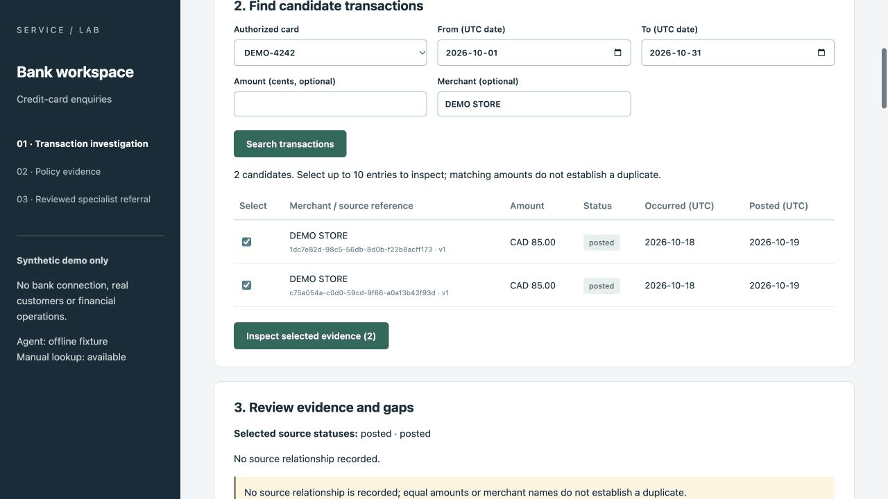
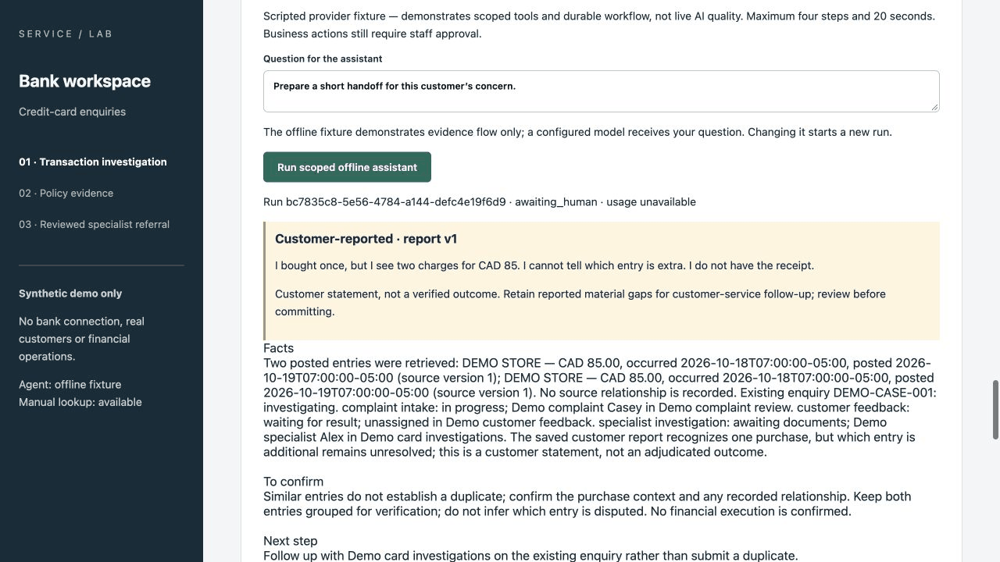
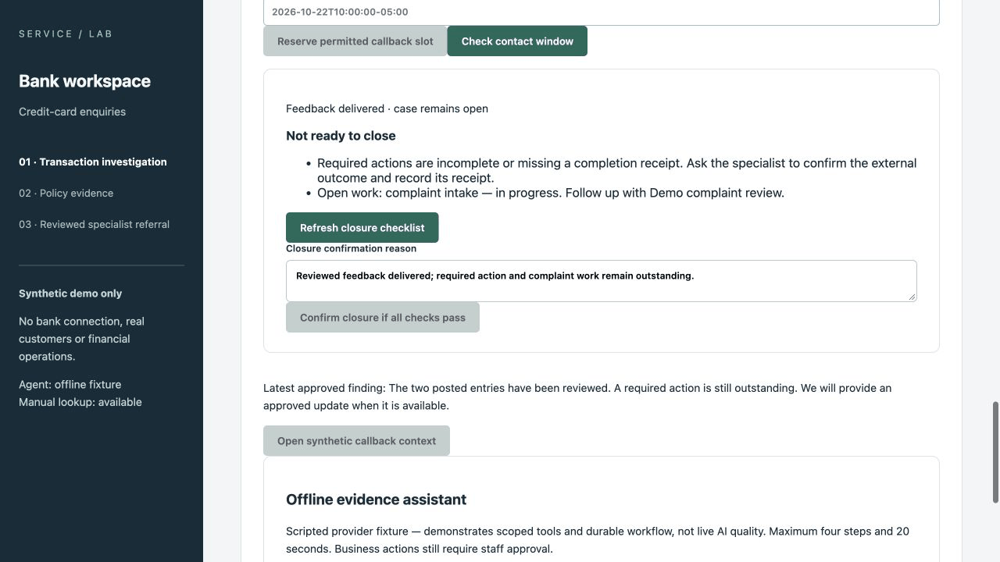

# Service Agent Portfolio

[](https://github.com/xc8609/service-agent-portfolio/actions/workflows/portfolio-checks.yml)
[](https://github.com/xc8609/service-agent-portfolio/actions/workflows/bank-runtime.yml)

**A bank service workspace that brings transaction investigation, Agent assistance
and customer follow-up into one workflow.**

A customer asks: **“I bought once — why do I see two credit-card charges?”**
The representative needs transaction details, the right handling procedure and a
clear next step. This project connects those tasks from the first enquiry through
specialist review and customer feedback.

It combines banking product and business-analysis experience with full-stack
engineering: business problem → requirements → story cards → implementation → acceptance.

[Case study](docs/case-study.md) · [Five-minute demo](docs/demo.md) ·
[Run locally](#run-the-demo) · [Trello](https://trello.com/b/wtNhuN0q/ai-agent)

## Core features

| Feature | What staff can do |
|---|---|
| Transaction investigation | Find charges by card, date, amount and merchant; compare status, currency and posting dates. |
| Customer context | Record the customer's statement and which entries they recognize; retain missing information for follow-up. |
| Case and procedure lookup | See related enquiries, progress, owners and applicable handling rules with source references. |
| Agent assistance | Assemble permitted evidence into **Facts / To confirm / Next step** and an editable service-note draft. |
| Specialist handoff | Review and submit an enquiry, link existing work, and pass along transaction evidence and material gaps. |
| Feedback and closure | Publish specialist findings, record verified customer feedback, and see outstanding actions before closing a case. |

| Investigate the charges | Review the Agent draft | Follow through to resolution |
|---|---|---|
|  |  |  |

## How the Agent fits

The Agent gathers transaction, case and procedure evidence through scoped tools,
keeps source references with its draft, and saves the result for staff review.
Staff can edit, approve or return a draft. Evidence changes trigger a fresh review;
permissions and business actions are enforced by the application.

The design separates **model providers**, **tool contracts** and **business workflow**.
This keeps model integration adaptable while retaining the same review and handoff process.
[Agent and application architecture](docs/architecture.md).

## Technology and structure

**React / TypeScript → FastAPI / Python → PostgreSQL**, packaged with Docker Compose
and tested with pytest, Playwright and GitHub Actions.

Transaction-source mapping examples and model-provider adapters sit behind small,
defined interfaces. Provider adapters cover OpenAI Responses, Claude Messages and
compatible-chat protocols. [Adaptation examples](examples/README.md) and
[design decisions](docs/architecture/ADR-004-lightweight-enterprise-adaptation.md)
explain how to extend the project for an institution's data and processes.

```text
docs/case-study.md + demo.md      Project overview and walkthrough
docs/backlog/                    Story cards, Sprint planning and traceability
projects/bank-service-assist/
  docs/                          Business analysis, processes and decisions
  specs/<STORY-ID>/               Requirements, design, tasks and acceptance
  specs/contracts/               Permissions, data model and tool/API contracts
  evaluation/                    Evaluation cases and results
apps/web/                        React workspace and browser tests
services/api/bank_api/
  agent/                         Agent runtime and provider adapters
  integrations/                  Transaction-source mapping
services/api/tests/              API and workflow regression tests
projects/complaint-analytics/    SQL, Tableau and complaint-routing analysis
docs/uat/ + .github/workflows/   Acceptance evidence and CI
```

## From BA design to working software

The repository connects process maps, decision rights, business rules and story
acceptance criteria to implementation and tests. [38 requirements](docs/backlog/traceability-matrix.md)
trace across the delivery lifecycle.

The bank core has passed its [delegated workflow assessment](docs/uat/bank-core-closeout.md).
As of 23 October 2026, verification includes **294 API tests, 45 browser tests**,
container smoke and offline Python 3.9/3.12 checks.

The companion [complaint analytics case](projects/complaint-analytics/README.md) uses
27,011 public CFPB complaints, SQL and Tableau to explore service operations. Its
frozen routing baseline reached 81.7% team accuracy versus 31.5% for the majority baseline.

## Run the demo

Requires Docker Compose:

```bash
python3 scripts/configure_demo.py
docker compose up --build --wait
```

Open **http://127.0.0.1:8000** and follow the [five-minute walkthrough](docs/demo.md).
The local demo uses synthetic bank records, simulated roles and an offline scripted
Agent provider; no model key is needed.
[Mac setup, tests and recovery](services/api/README.md).

## Roadmap

Next increments: hosted demonstration and live-model integration, followed by
telephone self-service with human handoff and a retail clienteling case.
[Delivery plan](docs/backlog/current-delivery.md).

[Business analysis](projects/bank-service-assist/docs/README.md) ·
[Detailed design](projects/bank-service-assist/specs/README.md) ·
[Acceptance](docs/uat/bank-core-closeout.md) · [Contributing](CONTRIBUTING.md) ·
[Security](SECURITY.md) · [MIT](LICENSE) · [Third-party notices](THIRD_PARTY_NOTICES.md)
