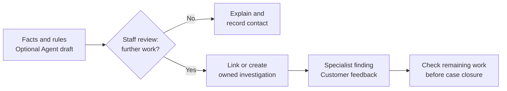

# Service Agent Portfolio

[](https://github.com/xc8609/service-agent-portfolio/actions/workflows/portfolio-checks.yml)
[](https://github.com/xc8609/service-agent-portfolio/actions/workflows/bank-runtime.yml)

**A bank service workspace that brings transaction investigation, Agent assistance
and customer follow-up into one workflow.**

A customer asks: **“I bought once — why do I see two credit-card charges?”**
The representative needs transaction details, the right handling procedure and a
clear next step. This project connects those tasks from the first enquiry through
a supported answer, or specialist review and customer feedback when needed.

It combines banking product and business-analysis experience with full-stack
engineering: business problem → requirements → story cards → implementation → acceptance.

[Case study](docs/case-study.md) · [Workflow and screenshots](docs/demo.md) ·
[Run locally](#run-the-demo) · [Trello](https://trello.com/b/wtNhuN0q/ai-agent)

## The business workflow

The starting pain is fragmented information: staff move between customer records,
transaction screens, case history and handling procedures. The target is one
workspace that supports the enquiry and keeps each next step owned.



| Stage | Business decision supported |
|---|---|
| Establish customer context | Which account can this representative access, and which purchase does the customer recognize? |
| Compare transactions | What do the amount, currency, dates and status actually establish? |
| Check cases and procedures | Is someone already investigating, and which handling rule applies? |
| Review an optional Agent draft | Are the facts, missing information and proposed next step supported by the evidence? |
| Hand off when needed | What needs investigation, who owns it, and what can be supplied later? |
| Follow up and close | Has the customer received the explanation, and what work still needs completion? |

Read the [five-minute walkthrough](docs/demo.md) directly on GitHub; screenshots
show the unresolved enquiry that needs specialist follow-up. A supported answer
with no further work can end with a saved contact note.

| Investigate the charges | Review the Agent draft | Follow through to resolution |
|---|---|---|
|  |  |  |

## How the Agent fits

The **workspace** brings permitted records and rules together. The **Agent** organizes
those sources around the representative's question into **Facts / To confirm / Next
step**, with references for review. It helps staff prepare an explanation or handoff;
the representative decides what to communicate and whether further work is needed.

Staff can edit, approve or return the draft and complete the workflow manually.
Evidence changes trigger a fresh review. The [case study](docs/case-study.md#agent-and-engineering-design)
shows the example and the alternatives considered before adding assistance.

The design separates **model providers**, **tool contracts** and **business workflow**.
This keeps model integration adaptable while retaining the same review and handoff process.
[Agent and application architecture](docs/architecture.md).

## From BA design to working software

The [case study](docs/case-study.md) explains the current process, target workflow,
responsibilities and intended business value. Process maps, decision rights and
story acceptance criteria connect to implementation and tests through
[38 requirements](docs/backlog/traceability-matrix.md).

For example: a customer recognizes one purchase but cannot distinguish two entries.
The BA decision preserves both as an unresolved pair; the UI, intake contract and
regression tests enforce it. [Follow this decision into implementation](projects/bank-service-assist/docs/README.md#one-decision-from-discovery-to-verification).

The bank core has passed its [delegated workflow assessment](docs/uat/bank-core-closeout.md).
As of 23 October 2026, verification includes **294 API tests, 45 browser tests**,
container smoke and offline Python 3.9/3.12 checks. A lookup rehearsal led to
specific improvements in transaction details and handoff completeness;
[findings and retest](docs/uat/2026-10-22-lookup-gap-retest.md) show that feedback loop.

The companion [complaint analytics case](projects/complaint-analytics/README.md) uses
27,011 public CFPB complaints, SQL and Tableau to explore service operations. Its
frozen routing baseline reached 81.7% team accuracy versus 31.5% for the majority baseline.

## Technology and structure

The [Retail Customer & Sales Analysis](projects/retail-customer-analytics/README.md)
case adds real transaction analysis: SQL source reconciliation, sales trends,
repeat-purchase cohorts and customer groups, presented through Tableau and three
portable visual reports. [Business findings](projects/retail-customer-analytics/docs/findings.md).

The second case, [Investment Research Brief](projects/investment-research/README.md),
is an independent Agent application for financial-report changes and research briefs.
Its manual workbench brings real financial facts, comparisons, sources and notes
together. It runs separately from the bank application; Agent drafting and saved
briefs follow in its [two-Sprint plan](docs/backlog/investment-research.md).

**React / TypeScript → FastAPI / Python → PostgreSQL**, packaged with Docker Compose
and tested with pytest, Playwright and GitHub Actions.

Transaction-source mapping examples and model-provider adapters sit behind small,
defined interfaces. Provider adapters cover OpenAI Responses, Claude Messages and
compatible-chat protocols. [Adaptation examples](examples/README.md) and
[design decisions](docs/architecture/ADR-004-lightweight-enterprise-adaptation.md)
explain how to extend the project for an institution's data and processes.

```text
docs/case-study.md + demo.md      Project overview and walkthrough
docs/backlog/                    Story cards, Sprint planning and traceability
projects/bank-service-assist/
  docs/                          Business analysis, processes and decisions
  specs/<STORY-ID>/               Requirements, design, tasks and acceptance
  specs/contracts/               Permissions, data model and tool/API contracts
  evaluation/                    Evaluation cases and results
apps/web/                        React workspace and browser tests
services/api/bank_api/
  agent/                         Agent runtime and provider adapters
  integrations/                  Transaction-source mapping
services/api/tests/              API and workflow regression tests
projects/complaint-analytics/    SQL, Tableau and complaint-routing analysis
projects/retail-customer-analytics/ SQL, Tableau and retail customer/sales analysis
projects/investment-research/   Independent research UI/API, calculator and BA design
docs/uat/ + .github/workflows/   Acceptance evidence and CI
```

## Run the demo

Requires Docker Compose:

```bash
python3 scripts/configure_demo.py
docker compose up --build --wait
```

Open **http://127.0.0.1:8000** and follow the [five-minute walkthrough](docs/demo.md).
The local demo uses synthetic bank records, simulated roles and an offline scripted
Agent provider; no model key is needed.
[Mac setup, tests and recovery](services/api/README.md).

## Roadmap

Current focus: retail customer/sales analysis and visualization alongside the bank
case's GitHub walkthrough. Investment Agent development is paused. Public hosting
and live-model integration remain deferred.
Future extensions include telephone self-service with human handoff and retail clienteling.
[Delivery plan](docs/backlog/current-delivery.md).

[Business analysis](projects/bank-service-assist/docs/README.md) ·
[Detailed design](projects/bank-service-assist/specs/README.md) ·
[Acceptance](docs/uat/bank-core-closeout.md) · [Contributing](CONTRIBUTING.md) ·
[Security](SECURITY.md) · [MIT](LICENSE) · [Third-party notices](THIRD_PARTY_NOTICES.md)
