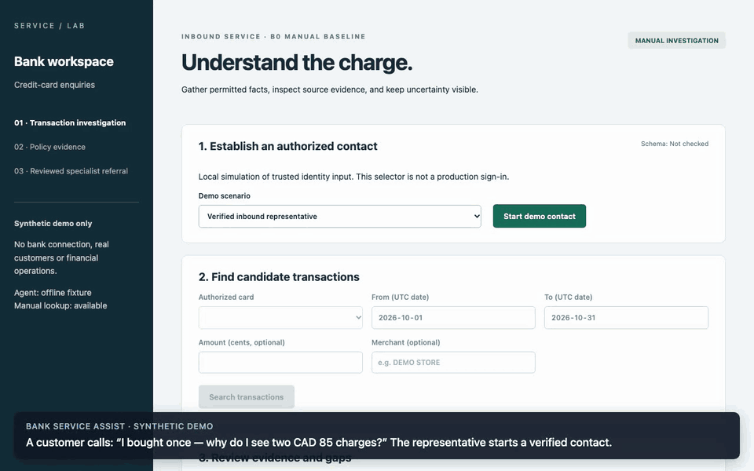
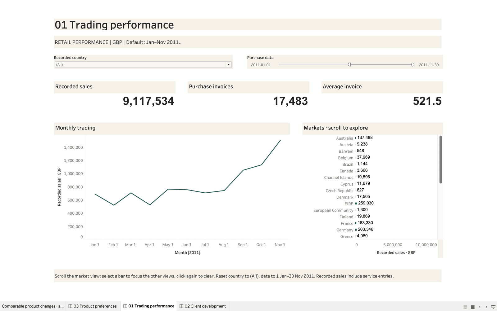

# Start here

A five-minute guide to this portfolio. It shows how business problems in banking,
retail and financial services become requirements, data analysis and working software.
All data is public or labelled synthetic; scenarios and stakeholders are simulated.

## The four cases in one minute

| Case | Business question | What was built | Result you can check |
|---|---|---|---|
| [Bank Service Assist](docs/case-study.md) | A customer sees two identical card charges — how does a representative investigate, hand off and follow up without losing context? | Requirements, process design and a full-stack workspace (React, FastAPI, PostgreSQL) with a bounded, reviewable Agent | [96-second recording](docs/media/bank-walkthrough.gif); 38 requirements linked to implementation and verification evidence |
| [Retail Customer & Sales Analysis](projects/retail-customer-analytics/README.md) | Sales rose 4.0% while orders fell 3.7% — which customers and products should the business investigate first? | Data cleaning, a DuckDB fact/dimension model, analytical SQL and a three-page Tableau workbook | Order decline reconciled to four customer groups; 591 lapsed repeat buyers defined for review |
| [Complaint Routing Analysis](projects/complaint-analytics/README.md) | Could a text suggestion help analysts route 27,011 public consumer-finance complaints? | SQL analysis, a two-page Tableau dashboard and a fixed hold-out model evaluation | 81.7% team accuracy vs 31.5% baseline — recommended analyst-confirmed suggestions, not automation |
| [Investment Research Brief](projects/investment-research/README.md) | Did a company's revenue growth carry through to profit and cash flow? | A separate research app: source-checked calculations and an Agent that drafts with citations | Every figure and explanation in the draft links to its report section |

## Choose a route

**Business analysis (about 5 minutes)**

1. [Bank case study](docs/case-study.md): current pain, target workflow, decision rights
   and what was deliberately left to people.
2. [One decision traced from discovery to tests](projects/bank-service-assist/docs/README.md#one-decision-from-discovery-to-verification):
   an unresolved pair of charges stays together instead of forcing a guess.
3. [Retail business case](projects/retail-customer-analytics/docs/business-case.md):
   turning “improve retention” into measures, a review group and a testable next step.
4. [Complaint requirements](projects/complaint-analytics/docs/01_business_requirements.md)
   and [evaluation](projects/complaint-analytics/docs/04_ai_pilot_evaluation.md):
   when a model is good enough to assist, and why it should not route on its own.

**Development (about 5 minutes)**

1. [Architecture](docs/architecture.md) and
   [adaptation design](docs/architecture/ADR-004-lightweight-enterprise-adaptation.md):
   model providers, tool contracts and business workflow kept separate.
2. [Agent runtime](services/api/bank_api/agent/): scoped read tools, drafts that
   require human approval, and replaceable provider adapters.
3. [API tests](services/api/tests/) and [browser tests](apps/web/tests/), run in
   [GitHub Actions](.github/workflows/) against PostgreSQL and a container build.
4. [Retail SQL model](projects/retail-customer-analytics/docs/model.md): grains,
   keys and source reconciliation, with [staging SQL](projects/retail-customer-analytics/sql/01_staging.sql).

**Data and BI (about 3 minutes)**

- [Retail Tableau pages](projects/retail-customer-analytics/README.md#three-decision-views)
  and [complaint dashboard](projects/complaint-analytics/dashboard/README.md), each
  checked against SQL results, with the definitions in their metric documents.

## What is and is not claimed

- **Measured:** test results, reconciled figures, and model scores on public data.
- **Simulated:** the bank, retailer, teams and stakeholders. Reviews and acceptance
  checks were done within this project (by the author or delegated automated checks),
  not by an employer or client.
- **Not claimed:** time savings, production readiness, live-model quality, or outcomes
  of any proposed business action.

Run the bank demo locally with Docker in two commands: [Run the demo](README.md#run-the-demo).
