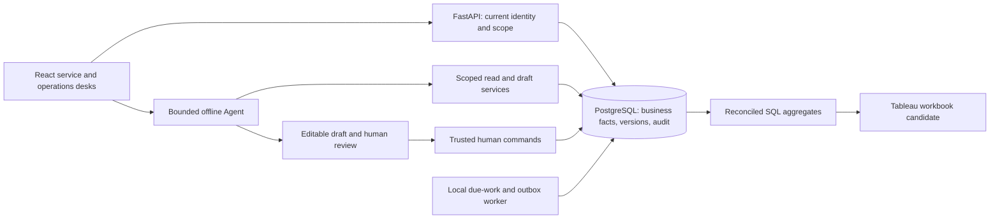

# Architecture and code ownership

Current implementation is one React workspace and one FastAPI application backed
by PostgreSQL. Keep this small: no separate microservice for each story or tool.
See [current delivery](backlog/current-delivery.md) for scope and implementation status.

## Current offline runtime

Live model qualification and Tableau refresh/layout acceptance remain pending.
The model receives a scoped DTO and read/draft tool schemas, never database access
or an approval tool. Trusted commands enforce current authority and source versions.

| Layer | Location | Responsibility and boundary |
|---|---|---|
| UI | `apps/web/src/` | Contact context, selection, evidence, draft review and operations desk; no authoritative role/state decisions |
| HTTP and read tools | `services/api/bank_api/app.py` | Session/scope validation, canonical reads, trusted commands and bounded assistant endpoints |
| Persistence | `services/api/bank_api/db.py`, `services/api/migrations/` | Restricted runtime role; ordered migrations; source versions and audit |
| Demo lifecycle | `fixtures.py`, `manage.py`, `local_postgres.py` under `services/api/` | Synthetic seed, guarded reset and isolated local database; separate from production identity |
| Agent | [Agent module boundary](../services/api/bank_api/agent/README.md) | Persisted offline orchestration, typed tool allowlist, cited drafts, provider adapters and disabled live profiles |
| Case progress reads | `services/api/bank_api/case_lookup.py` | Shared customer-safe snapshot, work ownership and conservative related-case review hints; no case mutation |
| Human report capture | `services/api/bank_api/investigation.py` | Scoped append-only statement/recognition revisions, concurrency and idempotency; not exposed to the model |
| Referral/note write services | `bank_api/proposals.py`, `referrals.py` | Human-approved commands, authorization, versions, idempotency and atomic writes; model tools cannot call approval commands |
| Durable continuation | `bank_api/worker.py`, `workflow.py`, `continuation.py`, `exceptions.py` | Persisted work/events and deadline checks; no long-lived model conversation used as a timer |
| Tests | `services/api/tests/`, `apps/web/tests/` | Database/API permission and failure tests; real UI journeys |

Domain services are separate from HTTP routing and shared by manual and assisted paths. Do not create empty controller/repository/framework layers merely
for appearance. Reuse one domain implementation for manual and assisted flows.

## Source of truth

- Business need and decisions: [business analysis index](../projects/bank-service-assist/docs/README.md).
- Work order and forecast: [delivery index](backlog/README.md).
- Story requirement, design, tasks and actual acceptance: [specification index](../projects/bank-service-assist/specs/README.md).
- Shared interfaces: [contracts](../projects/bank-service-assist/specs/contracts/interface-notes.md).
- Running implementation: source and migrations. A schema file is not proof that an endpoint exists.
- Trello mirrors work/decisions; Git retains the versioned specification and code.

D-23–D-25 remain accepted. v0.5 intake and DEV-11–13 runtime contracts capture
paired unresolved recognition, missing materials, contact resolution, accountable
callback and exception work. Scope and actual evidence are linked in the delivery ledger.

## Agent delivery constraints

DEV-09 implements offline-tested OpenAI Responses, Claude Messages and compatible-chat
adapters. They require explicit server qualification before live use; all are currently
disabled. The owner deferred live validation. SDKs are not needed for the current
small protocol boundary; request conversion stays separate from bank rules.

The first useful Agent gathers permitted facts and applicable rules, highlights
missing evidence and proposes an explanation or enquiry. Human review uses the
same deterministic command as the manual UI. A failed provider leaves the manual
path usable. Never give the model authority to refund, change verified contact
details, extend deadlines or claim a submission without a committed receipt.

DEV-05 adds `bank_api/policy_lookup.py` and `HandlingRules.tsx` within the existing
API/workspace. Deterministic metadata filtering and source reads serve both the
manual path and two canonical read tools; no provider, vector service or Agent
loop is introduced. [Policy runtime design](../projects/bank-service-assist/specs/DEV-05/runtime-contract.md).
