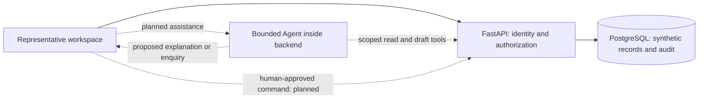

# Architecture and code ownership

Current implementation is one React workspace and one FastAPI application backed
by PostgreSQL. Keep this small: no separate microservice for each story or tool.
See [current delivery](backlog/current-delivery.md) for scope and implementation status.

## Runtime and planned extension

Solid lines are the existing manual read and customer-report capture path. Dashed lines are planned.
The Agent never obtains a privileged database connection or an approval tool.

| Layer | Location | Responsibility and boundary |
|---|---|---|
| UI | `apps/web/src/` | Contact context, query, explicit selection, evidence and later draft review; no authoritative role/state decisions |
| HTTP and read tools | `services/api/bank_api/app.py` | Current server-side session/scope validation and four canonical read endpoints plus the human related-case view |
| Persistence | `services/api/bank_api/db.py`, `services/api/migrations/` | Restricted runtime role; ordered migrations; source versions and audit |
| Demo lifecycle | `fixtures.py`, `manage.py`, `local_postgres.py` under `services/api/` | Synthetic seed, guarded reset and isolated local database; separate from production identity |
| Agent | [Agent module boundary](../services/api/bank_api/agent/README.md) | Planned orchestration, tool allowlist, evidence-backed drafts and provider adapter; currently no executable Agent code |
| Case progress reads | `services/api/bank_api/case_lookup.py` | Shared customer-safe snapshot, work ownership and conservative related-case review hints; no case mutation |
| Human report capture | `services/api/bank_api/investigation.py` | Scoped append-only statement/recognition revisions, concurrency and idempotency; not exposed to the model |
| Referral/note write services | Within `bank_api/`, planned DEV-06/07 | Human-approved commands, authorization, versions, idempotency and atomic writes; model tools cannot call approval commands |
| Durable continuation | Backend worker entrypoint when DEV-11–13 requires it | Persisted work/events and deadline checks; no long-lived model conversation used as a timer |
| Tests | `services/api/tests/`, `apps/web/tests/` | Database/API permission and failure tests; real UI journeys |

Extract domain services from the current small `app.py` when write workflows are
implemented. Do not create empty controller/repository/framework layers merely
for appearance. Reuse one domain implementation for manual and assisted flows.

## Source of truth

- Business need and decisions: [business analysis index](../projects/bank-service-assist/docs/README.md).
- Work order and forecast: [delivery index](backlog/README.md).
- Story requirement, design, tasks and actual acceptance: [specification index](../projects/bank-service-assist/specs/README.md).
- Shared interfaces: [contracts](../projects/bank-service-assist/specs/contracts/interface-notes.md).
- Running implementation: source and migrations. A schema file is not proof that an endpoint exists.
- Trello mirrors work/decisions; Git retains the versioned specification and code.

D-23–D-25 are accepted business rules. Their structured intake/continuation
extension is not yet in v0.4 referral schemas. D-23 recognition now has a separate
[human capture contract](../projects/bank-service-assist/specs/DEV-03/investigation-contract.md); referral and feedback writes remain planned. Keep that distinction
visible when changing JSON Schema, OpenAPI, persistence and UI together.

## Agent delivery constraints

Begin with one provider-neutral adapter and qualify one live provider in DEV-09.
SDK and provider selection remain pending; OpenAI/Claude/compatible API support
is not claimed merely because a common interface is planned. Keep provider
request/response conversion outside business rules. Add another provider only
with contract/evaluation evidence for its tool and structured-output behavior.

The first useful Agent gathers permitted facts and applicable rules, highlights
missing evidence and proposes an explanation or enquiry. Human review uses the
same deterministic command as the manual UI. A failed provider leaves the manual
path usable. Never give the model authority to refund, change verified contact
details, extend deadlines or claim a submission without a committed receipt.

DEV-05 adds `bank_api/policy_lookup.py` and `HandlingRules.tsx` within the existing
API/workspace. Deterministic metadata filtering and source reads serve both the
manual path and two canonical read tools; no provider, vector service or Agent
loop is introduced. [Policy runtime design](../projects/bank-service-assist/specs/DEV-05/runtime-contract.md).
