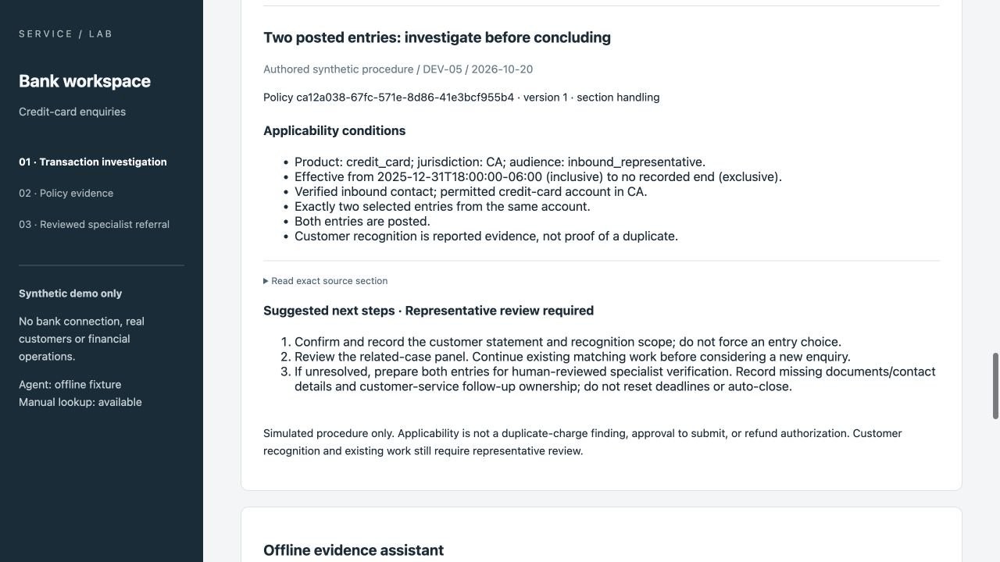

# Five-minute bank service demonstration

**Audience:** BA/BSA and developer reviewers. **Question:** “I bought once — why are
there two charges?” Show how a business problem became rules, software and test evidence.
This is a presentation script with actual screenshots, not a recorded video or a
five-minute customer-handling-time claim. [One-page case study](case-study.md).

## Prepare before presenting

- Start the [local demo](../README.md#run-the-demo) with fresh synthetic fixtures;
  [Mac setup and safe reset guidance](../services/api/README.md) covers expired fixtures.
  Keep the default October 2026 search dates and card `DEMO-4242`.
- The seed already contains `DEMO-CASE-001`. Continue that enquiry; do not create a
  second investigation just to make the presentation look complete.
- Rehearse the steps below, pre-type the supplied statement, and prepare the final
  feedback view or screenshot. Do not spend the presentation typing IDs.
- The callback happy path uses the configured service window: **09:00–17:00,
  America/Winnipeg, on a configured service date**. Out-of-window attempts are audited
  and sent to lead review. Outside that window, show the captured feedback state;
  do not bypass rules or describe an unexecuted callback as successful.
- Say up front: records and rules are synthetic; the app's assistant is an offline
  fixture. Subscription-model exploration is a separate exercise.

## Timed talk track

The time boxes total five minutes and include brief clicks. Use prepared views for
later stages; this is not an uninterrupted real customer call.

### 0:00–0:40 — Problem and scope

**Show:** the [case study](case-study.md) and transaction workspace.

> This project starts with a service-desk problem I understand from banking product
> and business-analysis work. A customer sees two similar charges, while the
> representative must find transaction details, check existing work and locate the
> right procedure. I designed one workspace to bring those steps together while
> preserving access restrictions. The goal is less searching and clearer handoffs.
> These are synthetic records; I am not claiming a bank deployment or measured savings.

### 0:40–1:30 — Establish facts before explaining

**Do:** **Verified inbound representative** → **Start demo contact**. Enter the statement
below *before* inspecting evidence. Search `DEMO STORE`, select both rows, then
**Inspect selected evidence (2)**.

> The representative can inspect only the authorized account. Both entries are posted
> for 85 Canadian dollars. The source does not record a relationship between them,
> so matching amounts do not prove a duplicate. The same workspace shows an existing
> enquiry, its progress and responsible queue. That gives staff an owned next step
> before another investigation is created.

### 1:30–2:20 — Explain the BA decisions

**Do:** choose **Recognizes one purchase; entry mapping unresolved** → **Save customer
report**. Show the rule's applicability, source version and suggested steps.

> I separated what the customer says from what the transaction source proves. If the
> customer cannot distinguish the entries, the process keeps them together rather
> than forcing a choice. A missing receipt is a recorded gap, not a reason to refuse
> the enquiry. The specialist decides whether it is needed; customer service owns
> the contact. Those decisions became story criteria, permission checks and tests.

### 2:20–3:20 — Show the Agent's actual contribution

**Do:** enter the question below → **Run scoped offline assistant**. Show **Facts /
To confirm / Next step** and **Sources and review checks**. In section 5: **Load note
history** → **Review saved note draft …** → review/edit → **Approve and commit note**.

> The assistant assembles permitted evidence into a draft staff can inspect and edit.
> It separates facts, uncertainty and next steps, with source references. It has no
> refund or approval authority. The running provider is scripted: this demonstrates
> integration and human review. Separately, I used twelve subscription-model scenarios
> to explore language interpretation, including tentative recognition and missing
> receipts. That exercise is labelled AI-assisted, not an independent benchmark.

### 3:20–4:15 — Show an accountable handoff

**Do:** section 6 → **Prepare fresh referral from selected pair**. Keep **Link existing
investigation**, add the material gap below, confirm the summarized concern, **Save
referral draft** → **Approve specialist enquiry**. Show the receipt. In section 7,
start **Demo specialist Alex** and open the `specialist_investigation` work.

> Approval links this contact to the existing enquiry. The specialist receives the
> customer's statement, selected transactions, unresolved recognition and missing
> material. There is a receipt and an accountable queue. The application records
> the handoff; the Agent does not claim it happened merely because it drafted a note.
> The manual workflow remains available without the assistant.

### 4:15–5:00 — Show completion boundaries and evidence

**Show:** prepared feedback view or [closure screenshot](images/closure-checklist.png).
Finish on [runtime CI](https://github.com/xc8609/service-agent-portfolio/actions/runs/39859494492).

> The specialist's approved explanation is separated from private notes. Disclosure
> requires a fresh identity check. Even after feedback is delivered, the case stays
> open if required actions or other work remain. The checklist tells staff what to
> follow up. The merged baseline passed 286 API and 44 browser tests, plus container
> and offline checks. Next, I will compare search effort, omissions and corrections
> on a few tasks, so the business-value claim can be based on observations.

## Copy-ready synthetic inputs

| Field | Text |
|---|---|
| Customer statement | I bought once, but I see two charges for CAD 85. I cannot tell which entry is extra. I do not have the receipt. |
| Assistant question | What is known about these charges, and who should handle the next step? |
| Material gap | Purchase receipt unavailable; specialist to assess whether it is needed. |
| Specialist's approved explanation | The two posted entries have been reviewed. A required action is still outstanding. We will provide an approved update when it is available. |

**Prepare the feedback scene:** as specialist, select **Further action required** and
publish the explanation above. Start **Feedback representative**, claim its task and
open a synthetic callback. Save and approve the feedback review, simulate verified
callback identity, retrieve the verified disclosure, then record **Verified, reviewed
feedback delivered** within the service window. The seeded case contains pending
action/complaint work: show **Feedback delivered · case remains open** and its blockers.
Do not force it closed. Browser regression **WF-06** covers successful closure after
all prerequisites are met.

Optional checks for a longer discussion: unclaimed feedback detail is denied; an
approved review without fresh callback verification still returns `AUTH_REQUIRED`.
Both were observed in the screenshot rehearsal.

## Screenshots and provenance

Captured from the actual local app on 22 October 2026, application code equivalent to
merged `761aeaf` (PR #26). Synthetic fixtures only. Images retain the visible offline
provider label, are exported as small palette PNGs and have no redrawn UI or added claims.

| View | What to notice |
|---|---|
| [Transaction evidence](images/evidence.png) | Two posted entries, source versions, no inferred duplicate. |
| [Handling rules](images/handling-rules.png) | Applicability, procedure version and staff-reviewed steps. |
| [Agent draft](images/assistant-draft.png) | Three-part summary, source/review control and uncommitted draft. |
| [Feedback and closure](images/closure-checklist.png) | Delivered is distinct from closed; follow-up stays visible. |

Capture/rehearsal evidence: the first three views used a fresh disposable instance;
the note and linked intake returned receipts, and unclaimed detail/unverified disclosure
were denied. Its callback at 17:11 Winnipeg time correctly entered lead review for an
out-of-window attempt. The final screenshot reopens the separate, persisted 15:51
verified-feedback state from the [core-clarity retest](uat/2026-10-22-core-clarity.md).
These are stages from two instances, not one uninterrupted successful call.
No clock, source data or workflow rows were edited to obtain the ending.

The presentation duration has not been measured. Owner UAT is recorded separately in
the [acceptance pack](uat/README.md); the script does not fill in its sign-off.
