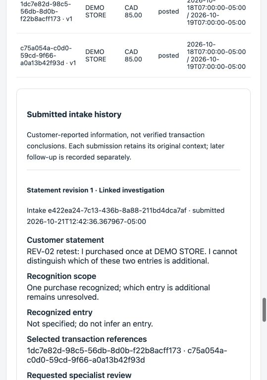
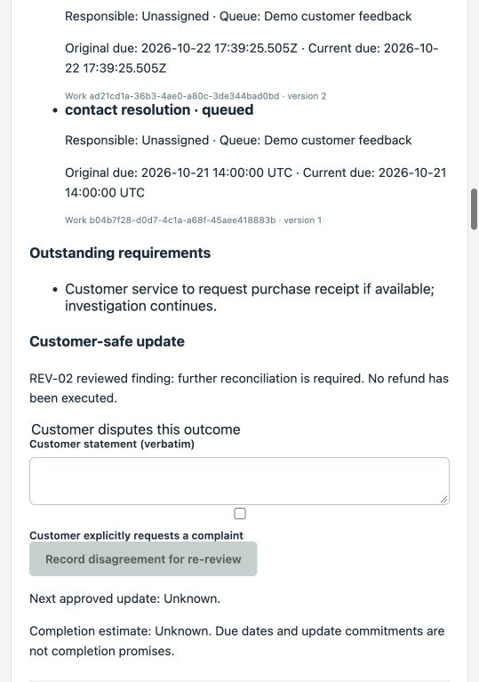

# REV-02 — observed bank-core retest

21 October 2026. Delegated assessor: Codex. **UAT-01, UAT-02 and UAT-03 passed
retest; the exercised core workflow passed with the limitations below.** This
supplements, rather than rewrites, the [original failed assessment](2026-10-21-delegated-assessment.md).
No owner personal sign-off, production release, live-model qualification or measured
bank benefit is implied.

## Tested baseline and entry gate

Application commit `9b614300c8cf27e396e46f4c346c7e9e073e4ec1`,
[PR #22](https://github.com/xc8609/service-agent-portfolio/pull/22), schema
`014_commitment_approval.sql`, synthetic fixture `bank-policy-synthetic-v3`.
Fresh worker-enabled PostgreSQL 16.2 demo at localhost port 5173; scripted assistant,
no real calls, bank connection, complaint transmission or money movement.

All four GitHub checks passed before interactive retest began:

- [Runtime and container run](https://github.com/xc8609/service-agent-portfolio/actions/runs/39645602519): PostgreSQL 17 API/browser 2m45s; container smoke 48s.
- [Offline run](https://github.com/xc8609/service-agent-portfolio/actions/runs/39645602532): Python 3.9 23s; Python 3.12 12s.
- Local: 232 API tests, 42 Chromium browser tests, 20 offline/SQL tests; lint,
  frontend build, spec/schema validators and publication checks passed.

This report/screenshot follow-up changes documentation only; the runtime code above
is the retested code. Final PR checks must also pass on the documentation commit.

## Interactive observations

| Flow / acceptance | Result |
|---|---|
| Unverified inbound | AUTH_REQUIRED; no transaction data |
| Query and recognition | Two CAD 85.00 posted entries; no source relationship; report revision 1 recorded one-purchase/unresolved mapping without choosing a duplicate |
| Rules and existing work / UAT-03 | Applicable policy and existing case retained; new guidance correctly directs explicit approved submission to section 6 |
| Offline Agent | Cited uncommitted draft, awaiting human; no automatic financial action |
| Reviewed referral | Missing purchase receipt and unusable contact accepted; linked existing work without another investigation |
| Specialist handoff / UAT-02 | Submitted statement/revision/timestamp, unresolved recognition, selected IDs, request, unknown clarification answers, material/contact gaps and ownership visible. Transaction IDs, versions, amounts and dates distinguish the pair |
| State concurrency | Worker advanced the case after opening details; stale publish received CONFLICT. Reloaded current work and reviewed before retry |
| Result / UAT-01 | Publishing marked the seeded pending commitment superseded internally. Repeated inbound refresh showed the approved finding and unknown next update, with no UNAPPROVED PRIVATE UPDATE text in the customer-safe case panel |
| Permission boundary | Feedback representative opening an unclaimed contact task received FORBIDDEN_OR_NOT_FOUND; claim then allowed required details |
| Contact gap resolution | Customer service recorded authorized synthetic contact confirmation; original due time remained unchanged; original intake still showed its historical contact gap with later resolution recorded separately |
| Reviewed callback | Approved explanation alone was insufficient: disclosure returned AUTH_REQUIRED. Fresh simulated verification then allowed the reviewed explanation only; specialist private notes absent |
| Feedback / closure | Recorded actual verified delivery, feedback completed. Attempted closure with pending required action returned CONFLICT; case was not falsely closed |

Evidence anchors: Agent run `66eac698-14b3-4c0c-abb4-fc16645df428`,
intake `e422ea24-7c13-436b-8a88-211bd4dca7af`,
referral receipt `bd73c35f-88a9-471e-8505-40ece0b5716f`,
result receipt `b4a0de88-d1bc-49b3-90d6-3845da355c62`,
feedback receipt `55405e75-1171-43a3-ab9f-e739ece636cd`. All are synthetic.

## Evidence and limits

- Browser regressions separately covered the distinct-new intake path and denied
  detail before specialist claim. API regressions covered new/linked multi-revision
  handoff, approved historical supersession, replay and conservative legacy migration.
- No-answer, three-day exhaustion, lead continuation, complaint retry/history and
  material-declined branches passed the full automated suites. They were not all
  manually repeated in this focused UI retest; their earlier observations remain in
  the original assessment. No simulated clock advance is presented as elapsed days.
- Known conservative guard limitation: the draft sentence “No duplicate conclusion
  or completed refund is confirmed” was rejected as UNSUPPORTED_CLAIM. Using the
  explicit “No refund has been executed” allowed review to continue. This false
  positive is recorded for future guard evaluation, not claimed as semantic accuracy.
- Receipt/projection controls use synthetic identities and local adapters. They do
  not qualify live identity, source connectors, providers or staging recovery.
- PR #22 depends on still-open PR #21. Review and merge remain outstanding; neither
  was merged as part of retest. Broader owner acceptance remains a separate decision.
