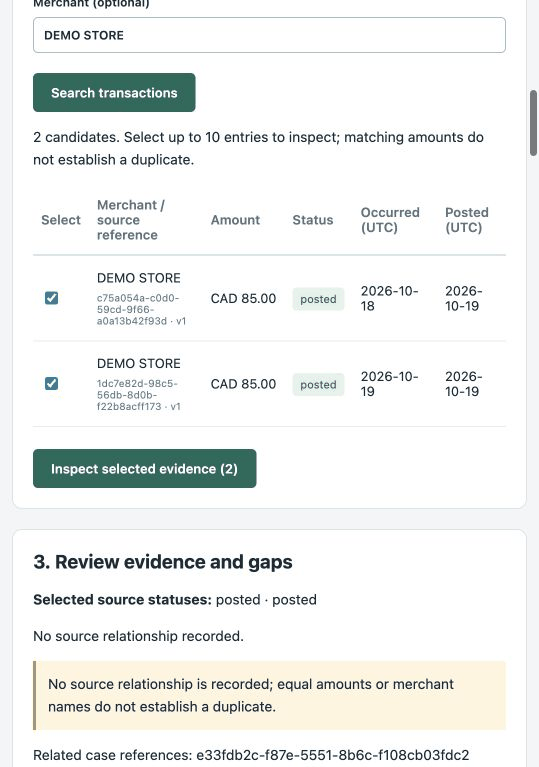
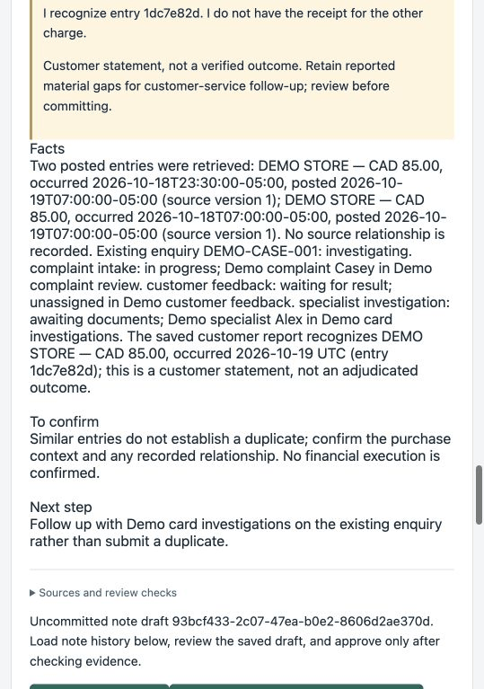

# UTC transaction label — targeted retest

23 October 2026 · DEV-08 / QA-03 · base `8a083a2`, branch `codex/dev08-utc-date`.
Codex implementation and delegated assessment; owner sign-off remains pending.

## Correction and regression

The specific-entry label previously took the first ten characters of a source
timestamp. `2026-10-18T23:30:00-05:00` consequently appeared as 18 October in the
Agent label, but 19 October in the table's UTC column. The label now converts to
UTC before taking the date and explicitly says `UTC`. Full source timestamps
retain their offsets; short IDs, recognition, permissions and workflows are unchanged.

LG-02's new API regression uses a real PostgreSQL connection with a test-only
`America/Winnipeg` session timezone, independent of the runner's timezone. It runs
the actual assistant endpoint, checks that offset-bearing evidence reaches the
summary and expects `occurred 2026-10-19 UTC`. It failed against the old code at
that expectation and passed after the fix. The existing same-day case also passes.

## Observed UI retest

Fresh disposable PostgreSQL 16.2; built React application; scripted offline Agent;
fixed test clock `2026-10-20T15:00:00Z`. Only the disposable `tx_equal_2` occurrence
time was changed to the cross-midnight example above. Repository seed data and the
owner's port-8000 demo were not changed. This is a controlled synthetic fixture.

| Step | Actual outcome |
|---|---|
| Verified contact → DEMO STORE lookup → select pair | Both CAD 85 posted records returned. Entry `1dc7e82d` shows occurrence `2026-10-19` under the UTC heading. |
| Related case and rules | DEMO-CASE-001 remains investigating, assigned to Demo card investigations; the two-posted-entry procedure retains uncertainty and recommends continuing matching work. |
| Save specific-entry recognition; run assistant | Report v1 is retained separately. The label reads `DEMO STORE — CAD 85.00, occurred 2026-10-19 UTC (entry 1dc7e82d)`; no duplicate/refund is asserted. |
| Reload run; open saved note | Same corrected label and original customer allegation retained. Draft awaits human review; no note was committed. |
| Change merchant query | Old Agent preview removed and note approval disabled. |
| Switch to unverified customer | `AUTH_REQUIRED`, no transaction table and disabled search. |

Exact saved statement: “I recognize entry 1dc7e82d. I do not have the receipt for the
other charge.” Run `9e32b18d-145a-4511-b381-c8b22efd60d6`; uncommitted draft
`93bcf433-2c07-47ea-b0e2-8606d2ae370d`.

| Transaction table | Agent preview |
|---|---|
|  |  |

## Verification scope

- **294 API tests passed**, including the new cross-midnight regression.
- **45 browser tests passed**, zero retries, on a separate standard-seed disposable
  server. These include note/referral receipts, specialist takeover and findings,
  claim-before-detail, fresh callback verification, feedback and closure blockers.
- **109 offline tests passed; two optional SQL modules skipped** locally because
  DuckDB was unavailable. Build/typecheck, Ruff, spec/contract and publication checks passed.

The first local browser attempt used unsupported port 5174: the origin guard
blocked static assets, two tests timed out and the run was stopped. Rerunning on
the existing allowed origin 5173 passed; no origin or security setting changed.
An initial regression-harness connection-option error was corrected before the
old-code failure/new-code pass comparison. One manual locator miss and an appended
draft statement were corrected before saving; no timing benefit is claimed.

The UI walkthrough above covers inbound lookup through the uncommitted note.
Specialist/feedback continuation was retested by the full automated suite, not
repeated manually. This is not live-model qualification, owner UAT, production
acceptance or a new efficiency study. The 22 October observations remain unchanged.
