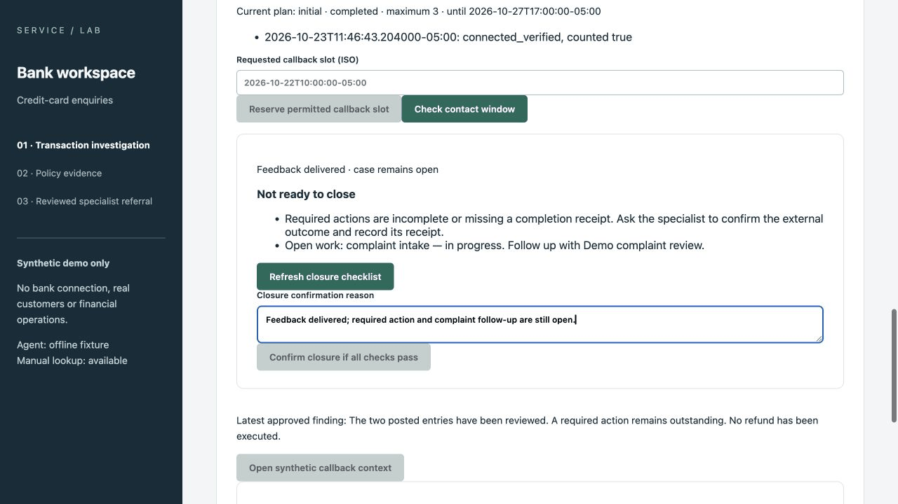

# Bank core — delivery and delegated acceptance

23 October 2026 · QA-03 / OPS-03 · Assessor: Codex, at the owner's request.
Application baseline: `0799865ce9d5463e18feb4be5af61c1bf5c046ef` (merged PR #30).

**Decision: pass for the bounded, local, synthetic bank portfolio demonstration,
with the limitations below.** Requirements, implementation, regression testing and
delegated workflow assessment are connected and reviewable. No blocking defect was
found in this assessed core. This is not completion of the entire original roadmap,
an independent human UAT study, the owner's personal signature or production approval.

## What is complete, and at what level?

| Delivery activity | Current outcome | Evidence |
|---|---|---|
| Business analysis | Core problem, current/target process, roles, rules and exceptions documented; D-17–25 accepted by the owner | [BA navigation](../../projects/bank-service-assist/docs/README.md), [decision log](../../projects/bank-service-assist/docs/sprint-01/decision-log.md) |
| Stories and detailed design | Core story specs, acceptance criteria, permissions, data model and tool/command contracts authored | [Story catalogue](../backlog/story-cards.md), [specification index](../../projects/bank-service-assist/specs/README.md) |
| Development and review | Core bank workflow and bounded offline Agent merged through PR #30 | [Execution ledger](../backlog/dev-execution-ledger.md), [UTC correction](https://github.com/xc8609/service-agent-portfolio/pull/30) |
| Engineering verification | 294 API tests, 45 browser tests, container smoke and offline Python 3.9/3.12 checks pass on this main commit | [Main runtime CI](https://github.com/xc8609/service-agent-portfolio/actions/runs/39988981068), [main offline CI](https://github.com/xc8609/service-agent-portfolio/actions/runs/39988981114) |
| Business-flow assessment | Delegated core assessment passes; every U1–U15 scenario has executed evidence, with its method identified below | Scenario matrix and fresh observations below |
| Local delivery | Reproducible local setup, smoke check, operating limits, five-minute script and case study available | [Run/recovery guide](../../services/api/README.md), [demo](../demo.md), [case study](../case-study.md) |
| Wider release | Full B1 roadmap, public hosting, live-model qualification and human benefit validation remain incomplete | Explicit remainder below |

The [38-requirement matrix](../backlog/traceability-matrix.md) retains broader
requirement-level gates. Its personal-owner-UAT status does not mean the delegated
checks below were never performed. Conversely, a passed core scenario does not
silently complete every criterion on its parent story. Sprint forecasts describe
planned capacity for a simulated team, not actual elapsed delivery time.

## Acceptance coverage

All automated cases below passed in the linked main CI. **Interactive** means Codex
operated the app; **automated** means the named regression executed. This is a mixed
evidence assessment, not a claim that a human manually repeated all fifteen scenarios.
The [owner walkthrough](README.md#scenarios) remains available without repeating the
already accepted business-rule questions.

| Scenario | Result and method | Evidence |
|---|---|---|
| U1 — identity denial | Pass, interactive + automated | Fresh run A below; `AUTH-UI` |
| U2 — transaction facts and uncertainty | Pass, interactive + automated | Run A; `UI-01`, `UI-02`; [cross-day retest](2026-10-23-utc-date-retest.md) |
| U3 — unresolved recognition | Pass, interactive + automated | Run A; `SI-01/02/03` |
| U4 — rules and related work | Pass, interactive + automated | Run A; `RP-01`, `CK-01/02/05/07` |
| U5 — return an Agent draft without committing | Pass, automated | `NOTE-04`; `test_agent_draft_rejection_is_a_separate_human_decision` |
| U6 — reviewed note receipt | Pass, interactive + automated | Run A; `NOTE-01` |
| U7 — missing material/contact and preserved deadlines | Pass, mixed evidence | Run A verifies missing receipt and linked work; `REF-02` and `test_distinct_enquiry_with_material_contact_gaps_has_owned_work` verify distinct work/contact gaps |
| U8 — declined material returns to specialist | Pass, automated | `WF-02`; `test_material_answer_returns_work_to_specialist_and_finding_supersedes_open_requests` |
| U9 — specialist result and private-note boundary | Pass, interactive + automated | Runs A/B; `WF-01`, `WF-04`, `WF-05` |
| U10 — unsuccessful contact stays open | Pass, automated | `test_verification_failure_and_never_dialed_fault_remain_outstanding`; `test_three_daily_attempts_exhaust_without_closing` |
| U11 — fresh identity, actual feedback and closure checks | Pass, interactive + automated | Run B; `WF-01`, `WF-06`; successful closure after prerequisites is automated |
| U12 — lead continuation preserves history | Pass, automated | `test_window_expires_then_lead_hold_and_bounded_new_plan` |
| U13 — disagreement and re-review | Pass, automated | `WF-03`; `test_inbound_objection_reopens_closed_case_and_keeps_closure_history` |
| U14 — complaint delivery and acknowledgement | Pass, automated | `test_complaint_delivery_is_requested_by_worker_and_acknowledged_by_receipt`; synthetic delivery adapter, no real complaint sent |
| U15 — usable manual fallback | Pass, automated | `NOTE-01`, `REF-01`; `test_unqualified_route_records_failure_without_transport_and_manual_path_remains` |

## Fresh interactive observations

Two separate disposable PostgreSQL 16.2 instances on port 5173, same built React
app and application baseline. The owner's port-8000 instance was untouched.
No direct database edits or clock changes were used during either walkthrough;
all business state changes used the normal application controls.
No real customer call, refund, bank connection or model API was used.

**Run A — fixed test clock, `2026-10-20T15:00:00Z`.** Unverified contact returned
`AUTH_REQUIRED`. Verified DEMO STORE search returned two posted CAD 85 entries,
explicit UTC dates and no recorded relationship. Existing DEMO-CASE-001 and the
two-posted-entry procedure were visible. Saved statement: “I bought once, but I see
two charges for CAD 85. I cannot tell which entry is extra. I do not have the receipt.”
Recognition stayed unresolved. The Agent retained this statement separately and
suggested following existing work without asserting duplicate/refund completion.

Staff committed the reviewed note and a referral with the receipt gap. The referral
linked the existing investigation. The specialist saw the exact statement, unresolved
pair and material ownership; original due time stayed `2026-10-21T09:00:00-05:00`.
After a finding was published, unclaimed feedback detail was denied; claim enabled
necessary detail without the specialist's private note. Run A ended before recording
a callback because the browser uses wall-clock timestamps. It is not counted as a
completed callback.

Run A references: Agent `5580eec6-8968-412f-9de1-2e93fabc7d3f`; note receipt
`171a8bc8-a5a0-4e1b-bbff-5ecbf8a1dade`; referral receipt
`1bbfa7cd-1e2b-4655-a2c7-ee9a1653667d`.

**Run B — real wall clock, 23 October, approximately 11:45–11:47 Winnipeg.** Fresh
standard seed, starting at the existing specialist case; it does not contain Run A's
intake. Published a synthetic finding, claimed feedback and approved the explanation.
Disclosure still returned `AUTH_REQUIRED` until fresh callback verification. Then
only the reviewed customer explanation was disclosed. Recording verified delivery
returned receipt `64189b42-1758-4817-9d7e-cdb192fcebff` at
`2026-10-23T11:46:43.204000-05:00`. Feedback completed; the case remained open.
Missing action receipt and open complaint work were listed, and closure remained
disabled even after entering a reason. No prerequisite was bypassed to force closure.

One automation locator did not match and one role selection was retried after state
inspection. Neither caused a saved business change or a product failure. Historical
failed assessments and their subsequent corrections remain intact.

## Explicit remainder — no new core development required for this demo

- **Personal owner sign-off:** not fabricated. The owner may use the existing pack
  for their own recorded review; this report is the delegated assessment they requested.
- **Live-model quality:** scripted runtime plus a separate 12-case subscription
  exercise. API routes, budget approval and independent evaluation remain deferred.
- **Benefits:** the four-task rehearsal and corrected omissions are real observations;
  representative handling-time/cost savings and user adoption are not established.
- **Broader nonfunctional acceptance:** measured latency targets (NFR-02), a full
  accessibility audit (NFR-03), retention automation (NFR-04), Tableau refresh/layout,
  and staging identity/backup/restore remain open in the original backlog. Passing
  functional tests does not satisfy those gates. The conservative text guard can
  reject some valid phrasing; staff can edit the draft or use the manual path.
- **Deployment and expansion:** local synthetic demonstration only. Public hosting,
  production access, autonomous phone handling and retail are later releases.

The next useful activity is to present this bounded case and gather feedback, not
to add another micro-feature merely to keep development moving. Reopen the core only
for a demonstrated blocker; choose live models or hosted deployment explicitly as a
new increment. This decision closes the delegated **offline core assessment**, not
the full QA-03/OPS-03 parent stories or all original Sprint/release gates.
