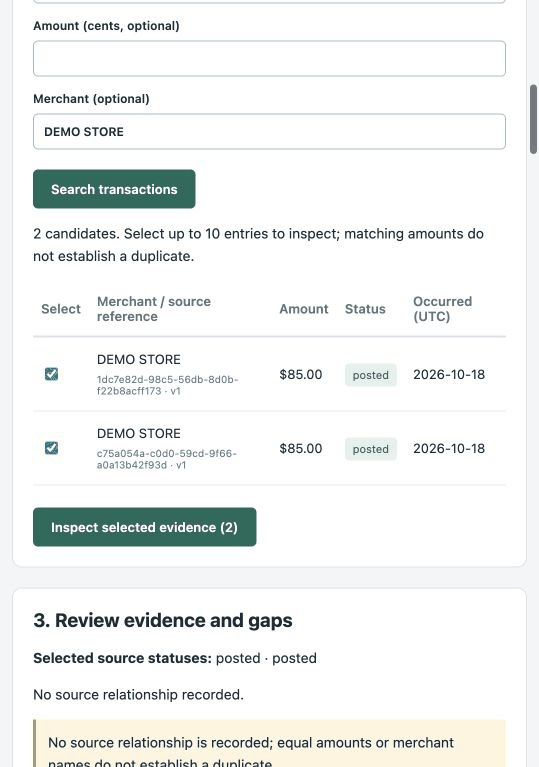
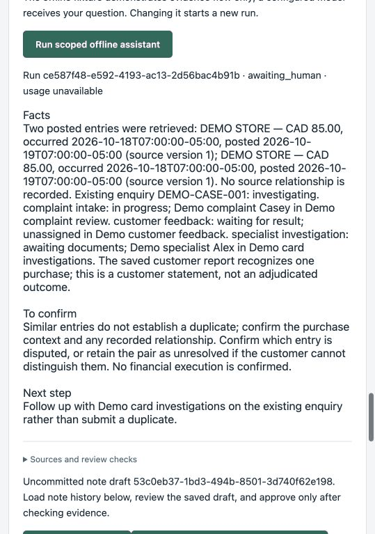

# Four-task lookup rehearsal — observed results

22 October 2026 · QA-03 / BR-01 · **Codex-operated, AI-assisted development evidence.**

The workspace kept the work on one page, but this rehearsal **did not establish a
speed or accuracy benefit**. Existing-case and procedure lookup covered all checklist
items in both conditions. Manual transaction lookup lacked explicit currency and
posting date; the scripted handoff omitted two customer-context details.

## Setup and limits

- [Protocol v1](protocol.md) and its checklists were committed as `c6dd61b` before the
  attempts. Preparation was clarified to use matched verified sessions for the same
  seeded contact. The checklists were not changed after observing results.
- App: merged PR [#27](https://github.com/xc8609/service-agent-portfolio/pull/27),
  `81ae6f175bda58f4460aa03074ea79fb46951445`, disposable local PostgreSQL and demo server.
  Four tasks, eight attempts, alternating A→B / B→A. No real customer or bank data.
- **A:** four plain, separated source pages generated from authorized synthetic APIs.
  This is a deliberately constructed reading baseline, not an actual bank system.
- **B:** prepared integrated workspace; manual T1–T3 and scripted offline Agent T4.
  The offline fixture does not interpret the entered question. No API model was used.
- Both conditions began with the same selected pair and saved statement, revision 3.
  Setup, identity, search and between-task view resets were excluded. Accessibility
  text can expose more content than a human viewport. Codex authored the setup,
  operated both paths and scored them, with prior source knowledge; answers are not
  independent. A's explicit fields make missing B fields especially easy to detect.
- Wall time includes browser tooling, reading, model deliberation and answer recording.
  T2-B was interrupted by context compaction and its time is excluded from comparison.
  Selector retries also affected T1-B/T4-B. Do not infer human handling time, a percent
  improvement, significance, cost savings or production acceptance from these numbers.

## First-pass results

Completeness counts only the fixed required items; a partly supplied item is incomplete.
A safe statement that information is unavailable is not an unsupported assertion, but
does not fill that required item. T4-B is scored on the actual draft plus its visible
uncommitted status, before manual corrections.

| Task | A complete | B complete | A / B page changes | A / B recorded actions | A / B operator wall seconds | Observed gap |
|---|---:|---:|---:|---:|---:|---|
| T1 Transaction facts | 5/5 | 3/5 | 1 / 0 | 1 / 3 | 25.079 / 48.020 | B shows `$85.00` without CAD and only occurrence date, not posting date. |
| T2 Existing work and ownership | 5/5 | 5/5 | 1 / 0 | 1 / 1 | 10.099 / excluded | Both identify the case, work status, specialist and queue. |
| T3 Procedure and next action | 5/5 | 5/5 | 3 / 0 | 3 / 3 | 37.661 / 28.212 | Both preserve applicability and human review. |
| T4 Short handoff | 7/7 | 5/7 | 5 / 0 | 5 / 3 | 28.509 / 28.735 | B omits unavailable receipt and makes the already-unresolved entry mapping conditional. |

Across these tasks A supplied 22/22 items and B 18/22 on first pass. This is a small
checklist observation, **not a model accuracy estimate**. No unsupported factual or
financial-action assertion was observed in the eight recorded answers. Page changes
were 10 versus 0 by construction, while recorded actions were **10 versus 10** before
correction: within-page navigation, expansion and question entry still take work.
These are different operations, not interchangeable units of effort.

T4-B needed one additional jump to the saved customer report and a manual addition
(16.575 operator seconds). Its initial score remains 5/7; the proposed corrected
handoff covers 7/7, but was not committed as a business note. T1-B was not corrected
inside that attempt. T4's Agent later displayed CAD and posting dates, which does not
retroactively fill the manual T1 gaps.

## Decisions from the observations

1. **DEV-02:** show explicit currency and posting date beside the manual transaction
   details. These values already exist in authorized evidence; no new integration is
   needed. A missing posting date must remain visibly unknown.
2. **DEV-08:** preserve `one_purchase_unresolved` as the current customer-reported
   state and include the reported unavailable receipt. Staff should review and retain
   the material gap, not repeat a question already answered or infer an extra entry.
3. Retest T1/T4 after these small changes. Keep this report unchanged as first-run
   evidence. Do not add live models, voice automation or a new measurement platform
   to solve these display/draft gaps.

The findings support a specific refinement of the workflow; they do not close owner
UAT, authorize deployment or prove that the Agent saves time.

## Evidence provenance and reproduction

Source pack captured `2026-10-22T22:57:57.709086+00:00`; SHA-256 of `sources.json`:
`4ea89915f86f7ddb3bacd90fae3784e1a55207f101d7f999b0f6dd520905b5e8`.
The generated pack and raw browser output remain local and are not committed. The
snapshot hash identifies this run; fresh captures have new timestamps and hashes.

Screenshots below were captured after the attempts from the same local session,
before any fixes. They show the manual fields and the actual T4 draft/status; they
are supporting evidence, not recordings of elapsed task time.

| Manual transaction view | Actual first scripted handoff |
|---|---|
|  |  |

On a fresh disposable synthetic demo, after preparing the same statement and pair:

```bash
python3 projects/bank-service-assist/evaluation/effort/build_source_pack.py \
  --api http://127.0.0.1:8000 --output /tmp/bank-lookup-pack
python3 -m http.server 8766 --bind 127.0.0.1 --directory /tmp/bank-lookup-pack
```

Open the source index and the demo in separate tabs. Follow [the fixed tasks](protocol.md).
The builder establishes a local demo session and saves the synthetic statement only
when it differs from the latest report; it never approves a note, submits an enquiry
or executes a financial action. Use it only against a disposable local demo. A live
system or real customer comparison needs a separately authorized setup.

The following ledger preserves actual first responses and observed actions. Times are
UTC. Page preparation/reset clicks and read-only observation calls are excluded from
action counts; selector failures are listed separately.

### T1 — A

Start `2026-10-22T22:58:17.871Z`; end `2026-10-22T22:58:42.958Z`; 25.079 operator seconds.

Actions: Open Transaction source.

Locations: transactions. Page changes: 1.

> Both entries are posted at DEMO STORE for CAD 85 each. Both occurred 18 October 2026 and posted 19 October 2026. No relationship is recorded; matching values do not prove a duplicate.

Missing: none against this checklist. Unsupported assertions observed: none.

### T1 — B

Start `2026-10-22T22:58:43.323Z`; end `2026-10-22T22:59:31.343Z`; 48.020 operator seconds.

Actions: Scroll to candidate transactions → Scroll to evidence → Expand source provenance.

Locations: candidate transactions; evidence and provenance. Page changes: 0.

One failed locator attempt was followed by an accessibility-text read/click; its delay is included.

> Both selected entries are posted, shown as $85.00 at DEMO STORE, with occurrence date 18 October 2026. The manual transaction/evidence view does not display the currency code or posting date; verify these before quoting them. No source relationship is recorded and similarity does not prove a duplicate.

Missing: Explicit CAD currency in item 2; Posting date in item 3. Unsupported assertions observed: none.

### T2 — B

Start `2026-10-22T22:59:31.679Z`; end `2026-10-22T23:02:42.459Z`; 190.780 operator seconds.

Actions: Jump to Related cases.

Locations: Related cases. Page changes: 0.

**Timing excluded:** Context compaction interrupted this attempt; elapsed time is retained only for audit.

> DEMO-CASE-001 covers both entries and is investigating. Specialist work is awaiting documents, assigned to Demo specialist Alex in Demo card investigations. Continue that enquiry and follow up outstanding material rather than create another matching case.

Missing: none against this checklist. Unsupported assertions observed: none.

### T2 — A

Start `2026-10-22T23:02:50.252Z`; end `2026-10-22T23:03:00.351Z`; 10.099 operator seconds.

Actions: Open Case source.

Locations: cases. Page changes: 1.

> DEMO-CASE-001 covers the full selection and is investigating. The specialist investigation is awaiting documents, assigned to Demo specialist Alex in Demo card investigations. Continue the existing enquiry and request the receipt if available; do not create a duplicate case.

Missing: none against this checklist. Unsupported assertions observed: none.

### T3 — A

Start `2026-10-22T23:03:00.513Z`; end `2026-10-22T23:03:38.174Z`; 37.661 operator seconds.

Actions: Open Procedure source → Return to source index → Open Transaction source.

Locations: rules; transactions. Page changes: 3.

> Use the synthetic DEV-05 procedure Two posted entries: investigate before concluding, handling section version 1. It applies to a verified inbound representative and a CA credit-card account with two posted entries on the same account. Compare amounts, merchant, dates and recorded relationships; these records both show CAD 85 at DEMO STORE and no recorded relationship. Confirm whether the customer recognizes one purchase, one specific entry, both or neither; keep the pair grouped if mapping is unclear. Review existing work first. Any unresolved referral requires human review and is not authorization to refund or declare a duplicate.

Missing: none against this checklist. Unsupported assertions observed: none.

### T3 — B

Start `2026-10-22T23:04:00.876Z`; end `2026-10-22T23:04:29.088Z`; 28.212 operator seconds.

Actions: Jump to Handling rules → Expand exact source section → Jump to evidence.

Locations: handling rules; evidence. Page changes: 0.

> Use the synthetic DEV-05 Two posted entries: investigate before concluding procedure, handling section version 1. It applies to verified inbound contact on a permitted CA credit-card account with exactly two posted entries on the same account. Check source statuses and relationships; these two are posted with no recorded relationship and similarity does not establish duplication. Confirm the recognition scope and keep the pair grouped if the customer cannot identify the extra entry. Review existing work first and obtain human review before any new specialist enquiry; the rule does not authorize a refund or a duplicate-charge finding.

Missing: none against this checklist. Unsupported assertions observed: none.

### T4 — B

Start `2026-10-22T23:04:40.446Z`; end `2026-10-22T23:05:09.181Z`; 28.735 operator seconds.

Actions: Jump to offline assistant → Enter handoff question → Run scoped offline assistant.

Locations: offline assistant. Page changes: 0.

One failed locator attempt was followed by an accessibility-text read/click; its delay is included.

> Facts
> Two posted entries were retrieved: DEMO STORE — CAD 85.00, occurred 2026-10-18T07:00:00-05:00, posted 2026-10-19T07:00:00-05:00 (source version 1); DEMO STORE — CAD 85.00, occurred 2026-10-18T07:00:00-05:00, posted 2026-10-19T07:00:00-05:00 (source version 1). No source relationship is recorded. Existing enquiry DEMO-CASE-001: investigating. complaint intake: in progress; Demo complaint Casey in Demo complaint review. customer feedback: waiting for result; unassigned in Demo customer feedback. specialist investigation: awaiting documents; Demo specialist Alex in Demo card investigations. The saved customer report recognizes one purchase; this is a customer statement, not an adjudicated outcome.
>
> To confirm
> Similar entries do not establish a duplicate; confirm the purchase context and any recorded relationship. Confirm which entry is disputed, or retain the pair as unresolved if the customer cannot distinguish them. No financial execution is confirmed.
>
> Next step
> Follow up with Demo card investigations on the existing enquiry rather than submit a duplicate.

Missing: States unresolved entry mapping conditionally rather than preserving it as the current reported state; Receipt unavailable is omitted. Unsupported assertions observed: none.

Actual scripted run `ce587f48-e592-4193-ac13-2d56bac4b91b`; draft `53c0eb37-1bd3-494b-8501-3d740f62e198`. UI status: Uncommitted; awaiting human review.

Manual addition after checking the saved customer report:

> Add to the reviewed handoff: The customer reports one purchase, cannot identify which entry is extra, and has no receipt. Keep both entries grouped; record the material gap for customer-service follow-up.

One extra section jump; 16.575 seconds. Draft remained uncommitted.

### T4 — A

Start `2026-10-22T23:05:26.044Z`; end `2026-10-22T23:05:54.553Z`; 28.509 operator seconds.

Actions: Open Customer report source → Return to source index → Open Transaction source → Return to source index → Open Case source.

Locations: report; transactions; cases. Page changes: 5.

> Draft for staff review: the customer reports one purchase, cannot identify which entry is extra, and does not have the receipt. The ledger shows two posted CAD 85 entries at DEMO STORE with no recorded relationship; a duplicate has not been established. DEMO-CASE-001 already covers the pair and is investigating. Specialist work is awaiting documents with Demo specialist Alex in Demo card investigations. Continue that enquiry with both entries grouped, record the unavailable receipt and customer-service follow-up, and do not open a duplicate enquiry. This is a recommendation only; no note, enquiry, refund or customer outcome has been committed.

Missing: none against this checklist. Unsupported assertions observed: none.
