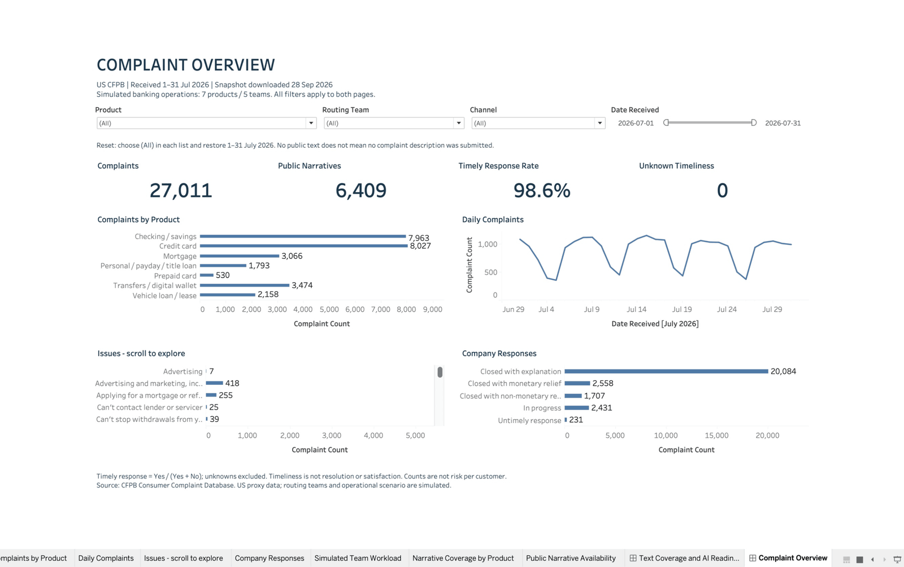
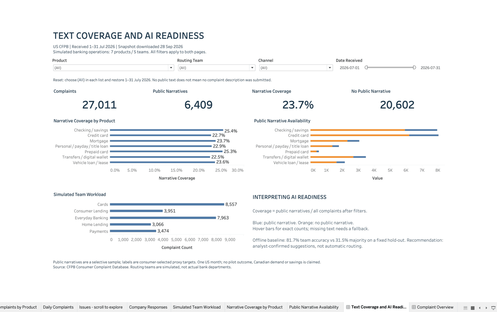

# Complaint Operations Dashboard — Tableau

Decision: Tableau selected by the owner on 2026-09-28 for the Mac workflow.
**Status:** SQL mart/export reconciled and the two-page [workbook](complaint_operations.twb)
(13 worksheets) checked natively in Tableau Desktop on 27 October 2026: shared product,
team, channel and date filters, intersections, an empty selection and reset match the
published CSV. Publication to a Tableau site is out of scope for the Free Edition.
[Verification notes](verification.md#native-filter-retest--27-october-2026).

| Complaint Overview | Text Coverage and AI Readiness |
|---|---|
|  |  |

This supports the simulated operations lead's US-2 in the
[requirements](../docs/01_business_requirements.md).
Tableau is our delivery choice; it does not demonstrate Power BI/DAX proficiency.

## First-release data flow

Official archive → local DuckDB staging → SQL aggregate mart → CSV → Tableau on Mac.
Supabase/PostgreSQL remains the candidate hosted database for later application
work; no cloud resource has been created. A PostgreSQL-capable Tableau edition can
later connect to equivalent SQL views. Do not assume all Tableau editions share
connectors or publishing options.

The installed application is **Tableau Desktop Free Edition 2026.2.3**. Its UI
allows local workbook editing/saving and says an upgrade is required for sharing
and publishing. No trial, purchase or publication was initiated. Public Edition
is a separate possible route for later public sharing; publishing is not part of
this draft. Only the prepared aggregate source is used; the real-text review
worksheet is a separate local artifact.

## Generate and connect

From the repository root, after profiling:

```bash
.venv-analytics/bin/python projects/complaint-analytics/scripts/export_tableau.py
```

1. Open Tableau and select **Connect → Text File**.
2. Select `projects/complaint-analytics/results/complaint_daily.csv` (or a regenerated copy).
3. Set `date_received` to Date. Keep product, issue, channel and company_response
   as string dimensions. Set the five `*_count` columns to whole-number measures.
4. Preserve the CSV field names for the calculations below (or adapt them if Tableau
   presents renamed fields). Use UTF-8 and a comma delimiter.
5. Open `complaint_operations.twb` in this directory. It points to `../results/complaint_daily.csv`
   relative to the workbook (not yet verified in Desktop). If Tableau cannot find it, use
   **Data → complaint_daily → Edit Connection**. No dataset is bundled in the `.twb`.
6. The draft contains **Complaint Overview** and **Text Coverage and AI Readiness**.
   Hide Show Me for more canvas space. Verify the checklist before presenting it as
   an accepted portfolio deliverable.

## Grain and scope

One row per **received date × product × issue × channel × company response**, with
the simulated `routing_team` for each product (it does not change the grain).
The file represents all 27,011 July 2026 complaints in the seven-product routing scope
defined in `sql/03_routing_scope.sql`. It includes records without narratives and
excludes other products. There are 5,228 aggregate rows.

No narratives, complaint IDs, company identifiers, ZIP codes or state fields are
exported. Grouping loses individual-record drill-through intentionally; issue-level
exploration remains possible. Use SUM of complaint_count, never the aggregate row
count, as complaint volume. Do not join these rows to another fact table in a way
that duplicates measures.

## Tableau calculated fields

**Complaints**
```text
SUM([complaint_count])
```

**Narrative Coverage** (format as percentage)
```text
IF SUM([complaint_count]) > 0 THEN
    SUM([narrative_count]) / SUM([complaint_count])
END
```

**Timely Response Rate** (format as percentage)
```text
IF SUM([timely_yes_count]) + SUM([timely_no_count]) > 0 THEN
    SUM([timely_yes_count]) /
    (SUM([timely_yes_count]) + SUM([timely_no_count]))
END
```

**Unknown Timeliness**
```text
SUM([timely_unknown_count])
```

Unknown timeliness is displayed separately and excluded from the rate denominator.
Compute rates from summed counts after filtering, never average per-row percentages.
A timely-response flag is not a final-resolution or customer-satisfaction measure.

## Two-page report design

| Page | Business question | Sheets |
|---|---|---|
| Complaint Overview | Which products and issues warrant further investigation? | Volume/timeliness KPI cards; daily volume line; product bars; issue bars; response-type distribution |
| Text Coverage & AI Readiness | Where is usable text available, and what limits classification? | Narrative count/coverage cards; coverage by product; text present/absent stacked bars; limitations note |

Date, product, channel and simulated-team controls share filter groups across all
13 worksheets, so each control applies to both pages (verified 27 October 2026). A visible
reset instruction describes restoring all values and the full date range. Start with all
teams and products selected. Avoid top-N issue filtering in global KPI denominators unless
explicitly labelled. Label the window July 1–31, 2026, US CFPB published complaints.
The source snapshot date is September 28, 2026. One month supports daily distribution,
not annual trends or seasonality. The offline routing baseline appears only as a cited text note; there is no savings chart.

## Acceptance / UAT checklist

SQL-to-CSV reconciliation below passed again on 2026-09-28. Native filter and layout
checks passed on 27 October 2026; results are in the verification notes.
The exporter also refuses missing/duplicate IDs or invalid received dates in scope.

| Unfiltered measure | SQL / CSV expected |
|---|---:|
| Complaints | 27,011 |
| Narratives | 6,409 |
| Timely Yes | 26,620 |
| Timely No | 391 |
| Unknown timeliness | 0 |

| Simulated team | Product filter | Expected complaints | Expected narratives |
|---|---|---:|---:|
| Cards | Credit card | 8,027 | 1,822 |
| Cards | Prepaid card | 530 | 134 |
| Consumer Lending | Payday loan, title loan, personal loan, or advance loan | 1,793 | 410 |
| Consumer Lending | Vehicle loan or lease | 2,158 | 509 |
| Everyday Banking | Checking or savings account | 7,963 | 2,025 |
| Home Lending | Mortgage | 3,066 | 728 |
| Payments | Money transfer, virtual currency, or money service | 3,474 | 781 |

- [x] Match all unfiltered KPI counts above in Tableau.
- [x] Apply a product filter and match its counts on both pages (Prepaid card and
  Mortgage checked; the other rows reconcile in SQL/CSV).
- [x] Verify team, channel and date filters affect every sheet; reset restores totals.
- [x] Empty selections show no data, not invented rates or zero accuracy.
- [x] Narrative and timeliness rates use weighted sums; unknowns remain visible.
- [x] Titles and notes explain scope, denominators and US/simulated-scenario boundaries.
  Tooltips were not re-inspected in this check.
- [x] Verify layout on Mac and inspect exported screenshots before claiming completion.

The detailed local check output is `data/processed/tableau_export_checks.json`.
Re-run profiling then the exporter after a source update; refresh the Tableau data
source and rerun the acceptance checks. Do not silently replace the fixed archive
with another period or publish it as a current/live operations dashboard.

## Business interpretation

See [initial findings and proposed decisions](findings.md). These connect descriptive
metrics to discovery priorities and the assisted-routing evaluation gate.
