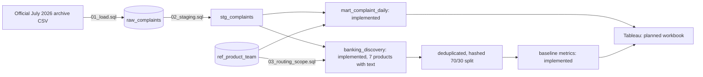

# Data Model

## Tables
| Layer | Object | Grain | Purpose |
|---|---|---|---|
| Raw | `raw_complaints` | 1 row per complaint | Untouched export, all text |
| Staging | `stg_complaints` | 1 row per complaint | Typed, renamed columns |
| Reference | `ref_product_team` | 1 row per in-scope product | Simulated product-to-team routing map; defines scope |
| Discovery | `banking_discovery` | 1 row per complaint | Nonblank text for the 7 in-scope products, with routing team; not a holdout |
| Mart | `mart_complaint_daily` | Date/product/issue/channel/response | Additive counts for Tableau |
| Eval | in-memory split | 1 row per deduplicated complaint with text | 70/30 hashed split after duplicate removal; metrics only in `results/model_baselines.json` |

The July archive has 16 source columns and no consent-status column. Source ZIP
codes remain in raw data but are excluded from staging. Original source rows are
retained; invalid IDs/dates become visible nulls and are counted in profiling.
The aggregate mart, Tableau CSV export, workbook draft and baseline model evaluation
are implemented; workbook acceptance and an annotated evaluation set remain open.
