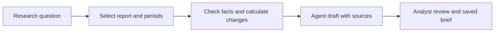
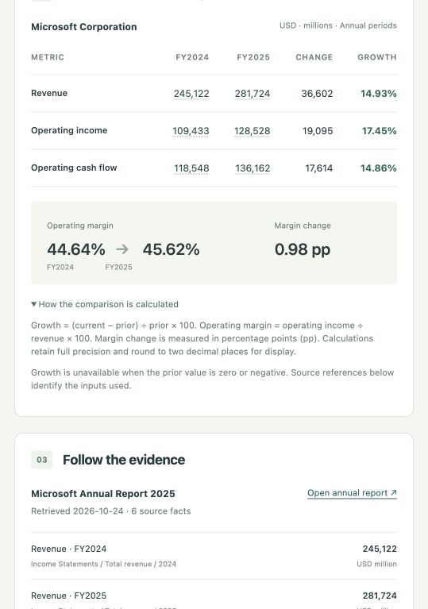

# Investment Research Brief

**Turn a company report into a checked, source-linked research brief.**

A new annual report arrives. An analyst needs to answer: **“Did revenue growth
translate into operating profit and cash flow, and what should I investigate next?”**
This independent Agent application connects financial facts, reproducible calculations
and an editable brief in one research workflow. It has its own UI, API and tools.

The first case uses Microsoft FY2025 and FY2024 figures from the same published
annual report. It complements the bank service case with public-data analysis,
evidence synthesis and research review.

## Workflow



The Agent will connect the question to relevant facts and explanations. Python
owns the arithmetic; the analyst owns the interpretation and final brief.

## Current increment

The **manual research workbench** brings the question, report selection, three-metric
comparison, source locators and analyst notes into one page. Its API uses the reviewed
six-fact pack and deterministic calculator. Refresh failures preserve current edits;
missing figures remain visible gaps. Agent drafting and saved/reviewed brief versions
follow in the second Sprint.

## Run the independent application

From the repository root, with Docker:

```bash
docker build -t investment-research projects/investment-research
docker run --rm -p 127.0.0.1:8010:8010 investment-research
```

Open **http://127.0.0.1:8010**. Select the prepared report, load the comparison,
inspect the source evidence, then write findings and follow-up questions. No bank
service or database is needed. Notes currently remain in the page until it closes;
saved versions are the next review-workflow increment.



For local development, with Python 3.12 and Node.js 24:

```bash
cd projects/investment-research
python3.12 -m venv .venv
.venv/bin/python -m pip install -r requirements-test.txt
npm --prefix web ci
npm --prefix web run build
PYTHONPATH=api:src .venv/bin/python -m uvicorn research_api.app:create_app --factory --port 8010
```

For frontend hot reload, run `npm --prefix web run dev` in another terminal; it
opens on port 5174 and proxies research requests to port 8010.

The calculation CLI also works independently of the application.

From the repository root, with Python 3.9 or later:

```bash
PYTHONPATH=projects/investment-research/src python3 -m research_brief \
  projects/investment-research/examples/msft-fy2025.json
```

The command works offline and returns JSON, including sources and calculation gaps.
It is the deterministic tool foundation for the Agent.

```text
docs/                  Business case, architecture and acceptance
api/research_api/       Independent FastAPI application and report registry
api/tests/             API and source-failure regressions
src/research_brief/     Pure Python validation and calculations
web/                   Independent React application and browser tests
examples/              Reviewed public facts with source references
Dockerfile             Build and run this application on its own
```

Tests from this project directory: `.venv/bin/python -m pytest`; with the API
running, `npm --prefix web run test:e2e`. Its own CI job runs these checks and
builds/tests the independent container. The pure calculation core also remains in
the portfolio's Python 3.9/3.12 offline checks.

## Read the design

| Question | Evidence |
|---|---|
| Who uses it, and why? | [Business problem, current/target process and BA decisions](docs/business-case.md) |
| How will the Agent work? | [Architecture, tools and data contract](docs/design.md) |
| What will be delivered, and when? | [Six story cards and two Sprint plan](../../docs/backlog/investment-research.md) |
| Are these real data? | [Source, mapping and actual retrieval record](data/README.md) |
| What has been verified? | [Calculation foundation](docs/acceptance.md) · [Workbench acceptance](docs/workbench-acceptance.md) |

Keep the first release small: one company, two annual periods, three operating
metrics and one reviewed brief. Live prices, portfolio trading and multi-agent
investment personas are outside this release.
