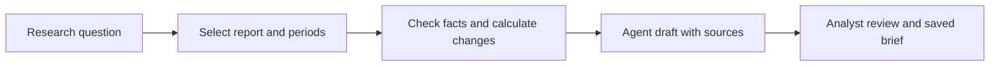

# Investment Research Brief

**Turn a company report into a checked, source-linked research brief.**

A new annual report arrives. An analyst needs to answer: **“Did revenue growth
translate into operating profit and cash flow, and what should I investigate next?”**
This project connects financial facts, reproducible calculations and an editable
Agent brief in one research workflow.

The first case uses Microsoft FY2025 and FY2024 figures from the same published
annual report. It complements the bank service case with public-data analysis,
evidence synthesis and research review.

## Workflow



The Agent will connect the question to relevant facts and explanations. Python
owns the arithmetic; the analyst owns the interpretation and final brief.

## Current increment

The **data and calculation foundation** runs locally: a reviewed six-fact source
pack, annual-period validation, growth/margin calculations and input references.
The research UI, Agent tool loop and saved-brief workflow are the next increments.

From the repository root, with Python 3.9 or later:

```bash
PYTHONPATH=projects/investment-research/src python3 -m research_brief \
  projects/investment-research/examples/msft-fy2025.json
```

The command works offline and returns JSON, including sources and calculation gaps.
It is the deterministic tool foundation for the Agent, not a generated research opinion.

## Read the design

| Question | Evidence |
|---|---|
| Who uses it, and why? | [Business problem, current/target process and BA decisions](docs/business-case.md) |
| How will the Agent work? | [Architecture, tools and data contract](docs/design.md) |
| What will be delivered, and when? | [Six story cards and two Sprint plan](../../docs/backlog/investment-research.md) |
| Are these real data? | [Source, mapping and actual retrieval record](data/README.md) |
| What has been verified? | [Acceptance and next increment](docs/acceptance.md) |

Keep the first release small: one company, two annual periods, three operating
metrics and one reviewed brief. Live prices, portfolio trading and multi-agent
investment personas are outside this release.
