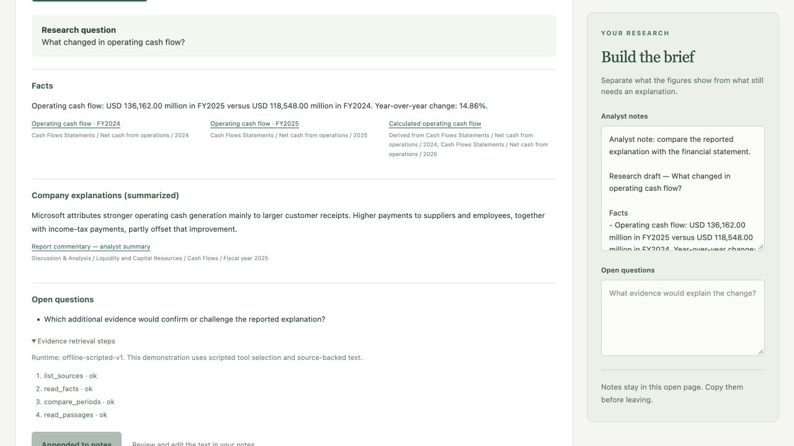

# INV-04 — research Agent acceptance

24 October 2026 · Delegated technical/workflow verification by Codex. This increment
implements evidence retrieval and cited drafts in the independent investment app.

## Executed workflow

With the independent API and built frontend, load the prepared Microsoft FY2025
report comparison and generate a draft for the research question.

| Task | Actual result |
|---|---|
| Did revenue growth translate into operating profit and cash flow? | Four read-only tool calls; three metric comparisons, one margin comparison and three attributed company explanations. Growth: 14.93%, 17.45%, 14.86%; margin: 44.64% → 45.62%, +0.98 percentage points. Quantifying the margin drivers remains an open question. |
| What changed in operating cash flow? | The same four tools; one cash-flow finding and the matching company explanation, with report locators. No unrelated revenue/profit explanation added. |
| Keep an analyst's existing note, then add the brief | Existing text remained unchanged during generation. Clicking **Append draft to notes** added the draft, source references and open question after it. |

The actual browser walkthrough inspected the citations and expanded the trace:
`list_sources → read_facts → compare_periods → read_passages`, all successful.

## Acceptance criteria and regression evidence

| Criterion | Verification |
|---|---|
| INV-04-AC1: checked numbers and cited explanations | Python tests exercise the original calculator through the tools. The final plan selects retrieved IDs; the renderer builds numeric text and source citations. Actual UI shows facts and company explanations separately. |
| INV-04-AC2: gaps and tool boundaries | Tests cover missing facts/commentary, mismatched report hashes, unavailable ratios, unsupported citations, arbitrary provider text, unknown tools, invalid arguments and attempted instruction/history manipulation. None enables a write or changes the tool catalogue. |
| INV-04-AC3: bounded execution and manual fallback | Tests cover the eight-call limit, provider failure, malformed plans, API source failures and stale context. Failed/incomplete drafts do not overwrite notes; the manual comparison remains usable. |
| Current-question consistency | API rejects stale report hashes; browser tests discard results after question changes or refresh and reject a mismatched response. |
| Independent application | No bank runtime, session, database or model API used. Docker packages the investment runtime and commentary independently. |

**Executed checks:**

- **93 project Python tests passed:** 43 calculator, 28 Agent runtime, 22 API.
- The 28 Agent tests also passed on Python 3.9.6; the application uses Python 3.12.
- **11 browser tests passed:** five workbench scenarios and six Agent scenarios.
  The successful draft path uses the actual local API/tools; failure/race scenarios
  use explicit response fixtures.
- TypeScript/Vite build, Ruff checks and API formatting passed.
- Full local offline portfolio suite: **180 passed**, two optional DuckDB modules skipped.
- A separate read-only review checked the real draft results, attribution, source
  identity, tool boundaries and independent packaging; no blocking issue remained.

The [investment CI workflow](../../../.github/workflows/investment-research.yml)
also builds the container and generates a cited cash-flow draft through its API.
The PR records that run's result. No local Docker execution is claimed here.

## Evidence scope and next work

The included provider is `offline-scripted-v1`. These results verify actual tool
execution, deterministic drafting and the application workflow. Retrieval is topic
selection over three reviewed report summaries; it is not whole-report semantic
search or live-model quality evaluation. This small evidence set is documented in
the [data record](../data/README.md).

INV-05 adds saved/reviewed brief versions and export. INV-06 will compare complete
manual and assisted tasks. No productivity improvement is inferred from this run.
