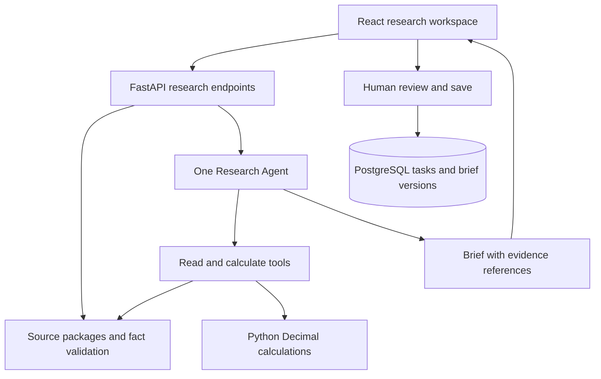

# Design — one researcher, checked evidence, reviewed output

24 October 2026 · Planned application design; the calculation package is implemented
first. UI, HTTP endpoints, persistence and model orchestration below are planned.

## Architecture and ownership

- **React/TypeScript:** a research page in the existing web application; company,
  periods, metric comparison, source evidence and brief editor.
- **FastAPI/Python:** a separate investment domain alongside the bank domain in
  the same deployment. Keep the existing bank endpoints and tables unchanged.
- **PostgreSQL:** task, source snapshot, research run and brief-version records.
  One database is enough; domain-specific table names prevent accidental mixing.
- **Research core:** `projects/investment-research/src/research_brief/` currently owns
  pure calculation/validation code. Future API tools call this code directly.
- **Runtime:** one Agent owns evidence gathering and the final draft. The application
  supplies tools, budgets, storage and human review. An SDK or provider adapter does
  not own the financial facts or the reviewed document.

The [OpenAI Agents SDK](https://developers.openai.com/api/docs/guides/agents/sdk)
is a candidate execution adapter when API integration is scheduled. Keep a small
`ResearchRunner.run(task, tools) → DraftResult` boundary so a different model runtime
can be added without changing facts or review semantics. OpenAI, Claude and compatible
API profiles are future choices; there is no new SDK dependency or paid call now.
Do not promise that changing an endpoint makes different providers equivalent.

Reuse the portfolio's CI, Docker setup and UI conventions. Do not import the bank
Agent runtime: its customer permissions, transaction pair and work-order state are
specific to service operations. Extract shared code only after duplication exists.

## Architecture choices

| Adopt | Keep out of this release |
|---|---|
| One Agent responsible for the research brief | Separate planner, writer, critic and investor-persona Agents |
| Facts with source, period and unit | Live multi-market pricing and trading calendars |
| Code-owned arithmetic with input references | Model-written formulas or arbitrary expression execution |
| A saved, reviewed brief linked to evidence | Long-term personal memory, broker connections and automatic trades |

The implementation and research prompts are original portfolio work. Architecture
inspiration is applied as design principles, without importing another product's
source code, prompts, user records or configuration.

## Data contract — current calculation input

[Example](../examples/msft-fy2025.json), schema version 1:

| Object | Required meaning |
|---|---|
| `issuer` | Stable company ID, name and SEC CIK for source identification. |
| `source` | ID, title, HTTPS URL, retrieval timestamp and downloaded-content SHA-256. |
| `periods` | Exactly two consecutive complete annual periods, with stable ID and inclusive start/end dates. |
| `facts` | Stable ID, supported metric, period ID, decimal value string, currency, unit/scale, source ID and table/row/year locator. |

Supported metrics: `revenue`, `operating_income`, `operating_cash_flow`. The initial
pack uses USD millions for consolidated Microsoft figures; all facts in a pack
must use the same currency and scale. The FY2024 comparative column is taken from
the FY2025 report, not silently merged with an earlier report edition.

`growth_pct = (current - prior) / prior × 100`; a zero/negative prior value leaves
growth unavailable with a reason. `operating_margin_pct = operating_income / revenue × 100`;
margin change is the current margin minus the prior margin, in **percentage points**.
Keep full Decimal precision until the final two-decimal display. Missing inputs
remain gaps. Reject duplicate facts, invalid references and incompatible periods/units.

Future explanatory passages have `evidence_id`, `source_id`, section locator and
text with an explicit `verbatim` or `analyst_summary` kind. They are source material,
not instructions to the Agent. The current six-number pack contains no explanation
passages, so it cannot establish causes of the financial changes.

## Four Agent tools — INV-04

| Tool | Input | Output |
|---|---|---|
| `list_sources` | Registered issuer ID | Available report IDs, dates, titles and URLs. |
| `read_facts` | Source and period IDs; supported metric IDs | Facts with units, dates and locators; explicit missing items. |
| `compare_periods` | Selected fact IDs | Validated calculations with formula, input IDs and any gaps. |
| `read_passages` | Registered source ID and research query | Relevant passages/section references from the selected report; empty if unavailable. |

The model may choose and repeat reads within a proposed limit of eight tool calls
per run. Tools accept registered IDs, not arbitrary URLs, SQL or Python. An invalid
tool result or exhausted budget leaves a recoverable draft/gap state. No model tool
marks a document reviewed or publishes it.

## Brief contract and application flow — INV-03/05

`ResearchTask`: ID, question, issuer, source snapshot ID, period IDs, selection version.
`DraftResult`: task/selection version, summary, metric comparison references,
explanations with evidence IDs, open questions, runtime identity and completion state.
`BriefVersion`: task, source hash, draft reference, edited content, author/reviewer,
version and review timestamp. Financial values remain bound to fact/calculation IDs.

Planned endpoints are `POST /v1/research/tasks`, `GET /v1/research/tasks/{id}`,
`POST /v1/research/tasks/{id}/runs`, `POST /v1/research/tasks/{id}/briefs` and
`GET /v1/research/briefs/{id}/export`. Use request/response schemas when implemented.
Task states stay small: preparing → draft → reviewed, with needs-review on changed
source selection. A failed Agent run leaves manual editing available. Save uses the
expected selection and brief version to prevent accepting an outdated draft.

There is no scheduler or deployment expansion in this increment. Normal request/run
status is enough; add streaming only if observed task latency warrants it.
