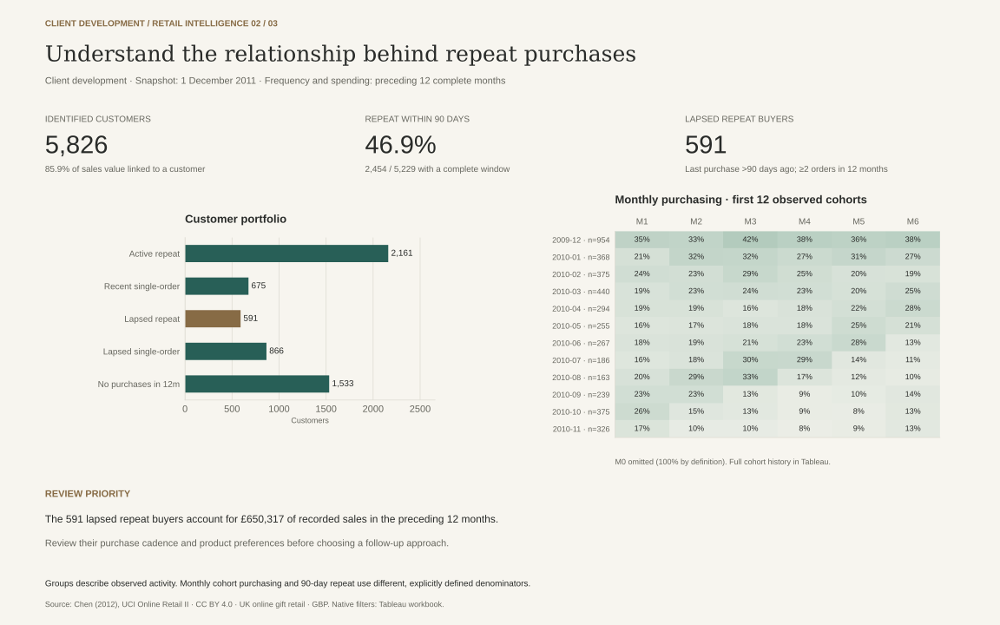
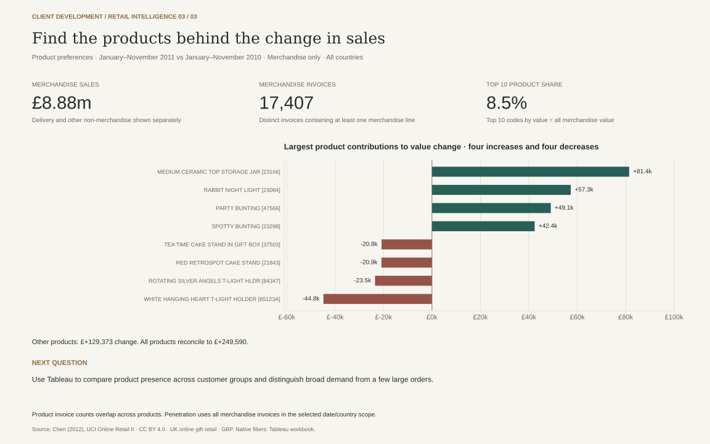

# Retail Customer & Sales Analysis

**What is driving sales changes, and which customer groups deserve a closer look?**

This case connects customer-development decisions with real retail transactions,
SQL and visual analysis. It builds on customer-management, commerce and payment
workflows: define the business question → reconcile data → explain the result →
propose a focused follow-up.

The source is UCI Online Retail II, a UK online gift retailer's invoice lines.
The case uses **24 complete months, 38,870 purchase invoices and 5,826 identified
customers** after reconciling overlapping source sheets.

## What the analysis shows

- **Sales +4.0%, invoices −3.7%, average invoice value +8.0%:** January–November
  2011 versus the same months of 2010. The headline increase hides a lower order count.
- **46.9% purchased again within 90 days:** 2,454 of 5,229 customers with a complete
  observation window. The broader two-year repeat-buyer share is 71.9%.
- **591 previously repeat buyers had not purchased for over 90 days:** their
  previous-12-month recorded sales total £650,317. This is a group to investigate,
  not proven lost revenue or a measured win-back opportunity.

[Five-minute business case and review](docs/business-case.md) · [Detailed findings](docs/findings.md) ·
[Metric definitions](docs/metrics.md) · [Stories and acceptance](../../docs/backlog/retail-analytics.md)

**Recommended business sequence:** investigate the continuing-customer order
decline, review lapsed-repeat customers' purchasing cadence, then use product and
market evidence to define the next action. The case study walks through all three
views and connects the findings to proposed business owners and follow-up evidence.

**Business review accepted — 24 October 2026:** the portfolio owner confirmed the
three-page findings and recommendation priorities. [Acceptance record](docs/business-case.md#business-acceptance-record).

[Dimensional model](docs/model.md) · [Client-development design](docs/client-development-design.md)

The model preserves invoice-line and order grains, standardizes product labels,
and keeps customer snapshots separate from transaction facts. The Tableau workbook
adds page-specific filters and selections for trading, clients and products.

The diagnostic increment explains the **676-invoice decline** through four
customer groups. Merchandise value grew from **£8.63m to £8.88m** in comparable
January–November periods; the top ten products contribute **8.49%** of current
merchandise value. [Diagnostic results](results/diagnostic_summary.json).

## Three decision views

Open [the portable review](dashboard/index.html) for the three previews below.
For native filtering and linked selections, generate the local inputs and open
[the Tableau workbook](dashboard/retail_customers.twb). It uses ignored local
transaction/customer exports and published cohort aggregates.
[Workbook setup and verification](dashboard/README.md).


| Client development | Product preferences |
|---|---|
|  |  |

[Dashboard instructions and verification](dashboard/README.md).

## Structure and reproduction

```text
docs/             Business case, metric definitions, findings
data/             Source attribution and checksum manifest
sql/              Staging, fact/dimension model and analytical marts
scripts/          Download/extract, analyze, render and build Tableau workbook
results/          Aggregate CSVs, findings inputs and reconciliation checks
dashboard/        Interactive Tableau workbook and portable review previews
tests/            Business-boundary, model and BI contract regressions
```

Python 3.12, from the repository root:

```bash
python3.12 -m venv .venv-retail
.venv-retail/bin/python -m pip install -r projects/retail-customer-analytics/requirements.txt
.venv-retail/bin/python projects/retail-customer-analytics/scripts/prepare_data.py
.venv-retail/bin/python projects/retail-customer-analytics/scripts/build_analysis.py
.venv-retail/bin/python projects/retail-customer-analytics/scripts/render_report.py
.venv-retail/bin/python projects/retail-customer-analytics/scripts/build_tableau.py
.venv-retail/bin/python -m pytest projects/retail-customer-analytics/tests -q
```

The 43.5 MB source download stays local. The pipeline verifies the pinned archive,
checks sheet overlap and reconciles detail to published aggregates. Customer
analysis covers the identified subset, representing 85.9% of recorded sales value.
Amounts are GBP; cancellation entries are shown separately. [Source and terms](data/README.md).
