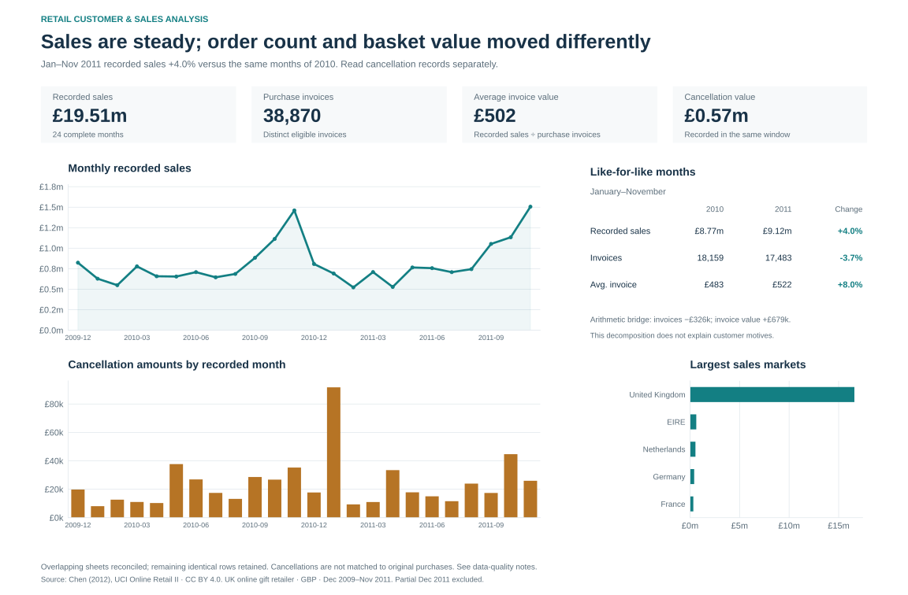
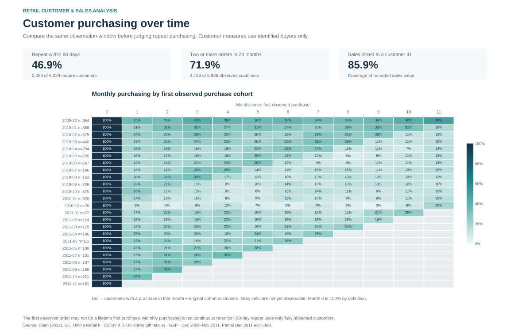
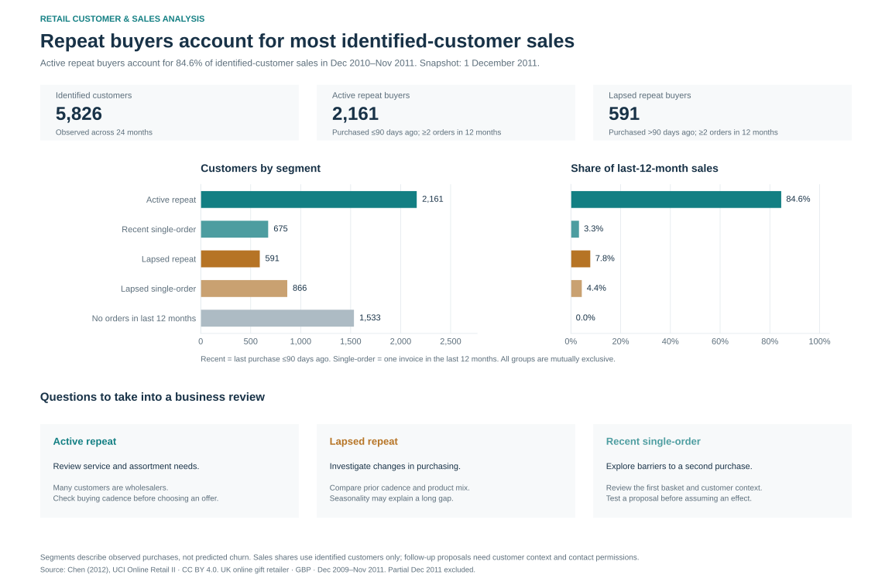

# Retail Customer & Sales Analysis

**Where is sales changing, and which customer groups deserve a closer look?**

This case connects customer-development decisions with real retail transactions,
SQL and visual analysis. It builds on customer-management, commerce and payment
workflows: define the business question → reconcile data → explain the result →
propose a focused follow-up.

The source is UCI Online Retail II, a UK online gift retailer's invoice lines.
The case uses **24 complete months, 38,870 purchase invoices and 5,826 identified
customers** after reconciling overlapping source sheets.

## What the analysis shows

- **Sales +4.0%, invoices −3.7%, average invoice value +8.0%:** January–November
  2011 versus the same months of 2010. The headline increase hides a lower order count.
- **46.9% purchased again within 90 days:** 2,454 of 5,229 customers with a complete
  observation window. The broader two-year repeat-buyer share is 71.9%.
- **591 previously repeat buyers had not purchased for over 90 days:** their
  previous-12-month recorded sales total £650,317. This is a group to investigate,
  not proven lost revenue or a measured win-back opportunity.

[Findings and proposed actions](docs/findings.md) · [Business case](docs/business-case.md) ·
[Metric definitions](docs/metrics.md) · [Stories and acceptance](../../docs/backlog/retail-analytics.md)

## Three visual views

Open [the portable report](dashboard/index.html) locally or download the
[Tableau workbook](dashboard/retail_customers.twb) with the adjacent `results/`
folder. The SVG views below render directly on GitHub.



| Customer purchasing | Customer priorities |
|---|---|
|  |  |

[Dashboard instructions and verification](dashboard/README.md).

## Structure and reproduction

```text
docs/             Business case, metric definitions, findings
data/             Source attribution and checksum manifest
sql/              Source selection, quality rules and analytical marts
scripts/          Download/extract, analyze, render and build Tableau workbook
results/          Aggregate CSVs, findings inputs and reconciliation checks
dashboard/        Tableau workbook, portable HTML report and SVG charts
tests/            Synthetic business-boundary regression cases
```

Python 3.12, from the repository root:

```bash
python3.12 -m venv .venv-retail
.venv-retail/bin/python -m pip install -r projects/retail-customer-analytics/requirements.txt
.venv-retail/bin/python projects/retail-customer-analytics/scripts/prepare_data.py
.venv-retail/bin/python projects/retail-customer-analytics/scripts/build_analysis.py
.venv-retail/bin/python projects/retail-customer-analytics/scripts/render_report.py
.venv-retail/bin/python projects/retail-customer-analytics/scripts/build_tableau.py
.venv-retail/bin/python -m pytest projects/retail-customer-analytics/tests -q
```

The 43.5 MB source download stays local. The pipeline verifies the pinned archive,
checks sheet overlap and reconciles detail to published aggregates. Customer
analysis covers the identified subset, representing 85.9% of recorded sales value.
Amounts are GBP; cancellation entries are shown separately. [Source and terms](data/README.md).
