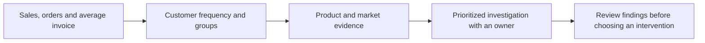

# Retail sales and client-development case study

**Sales grew 4.0%, but orders fell 3.7%. Which customers and products should the
business investigate first?**

This portfolio case connects a trading manager's sales review with customer
development and merchandising. It uses real UCI Online Retail II transactions
from a UK online gift retailer, including wholesale customers. The business
scenario is simulated and draws on sales-associate-system experience: customer
records should lead to a useful review priority, an accountable next step and
follow-up evidence.

**Delivered:** Python and DuckDB data preparation, two fact tables and four
dimensions, reconciled analytical results, and three interactive Tableau pages.
The analysis covers 24 complete months, 38,870 purchase invoices and 5,826
identified customers. Amounts are GBP.

[Dashboard and chart previews](../README.md#three-decision-views) ·
[Tableau setup and verified interactions](../dashboard/README.md) ·
[Detailed findings](findings.md) · [Source and licence](../data/README.md)

## Business problem and target process

In the simulated current process, a manager checks headline sales, then asks
different teams for customer and product spreadsheets. Different periods and
definitions can produce apparently conflicting answers and an unfocused request
to “improve retention.”

The target process gives the team one set of measures and a short decision path:



The analyst owns definitions and reconciliation. Trading, customer-development
and merchandising managers use the evidence to choose the next investigation.
The current deliverable supports that decision; it does not execute outreach.

## A five-minute walkthrough

### 1. Trading performance — explain the sales/order divergence


**Read:** compare January–November 2011 with the same months of 2010.

| Measure | 2010 | 2011 | Change |
|---|---:|---:|---:|
| Recorded sales | £8,765,001 | £9,117,534 | +4.0% |
| Purchase invoices | 18,159 | 17,483 | −3.7% |
| Average invoice | £482.68 | £521.51 | +8.0% |

**Explain:** larger average invoices accompany the sales increase, while the
business records 676 fewer orders. The customer bridge reconciles that decline:
**−1,047 + 3,832 − 3,261 − 200 = −676**. The same 2,596 customers buying in both
periods placed 13,498 orders before and 12,451 afterwards—about 5.20 versus 4.80
orders per customer.

**Decide:** investigate these continuing customers' purchasing intervals, order
sizes and product mix first. The arithmetic identifies where to look; it does
not establish a price increase or the reason for less frequent purchasing.

**Explore:** in Tableau, select a country or market bar to inspect its current
sales and monthly pattern, then clear it. The published year comparison and
customer bridge remain fixed all-market analyses.

[Source measures](../results/summary.json) · [Reconciled bridge](../results/order_bridge.csv)

### 2. Client development — choose a review group


**Read:** at the 1 December 2011 snapshot, **2,454 of 5,229 eligible customers
(46.9%)** purchased again within 90 days of their first observed purchase. The
71.9% who bought at least twice over the full two years have a longer observation
window; the two percentages are not a deterioration trend. In the heatmap, M1
means purchasing in the next calendar month, not continuous retention.

**Explain:** **591 lapsed-repeat customers** bought at least twice in the last
12 months but had not bought for over 90 days. Their recorded value in
December 2010–November 2011 was **£650,317**. This makes them a defined review
group; the purchase gap alone does not establish churn or recoverable revenue.

**Decide:** review expected ordering cadence, seasonal buying and recent service
issues before selecting an outreach approach. In an SA workflow, the next output
would be a reviewed customer list with a reason, owner and next action.

**Explore:** select Lapsed repeat to focus the group measures and cohort view,
then clear. The snapshot stays fixed when the Trading page's dates change.
Identified records cover 85.9% of recorded sales value, so coverage accompanies
customer conclusions.

[Group evidence](../results/segments.csv) · [Repeat and cohort definitions](metrics.md)

### 3. Product preferences — make the investigation specific


**Read:** comparable January–November merchandise value grew **2.9%**, from
£8,628,418 to £8,878,008. The ten highest-value products account for **8.49%** of
current merchandise value; review the wider assortment as well as best sellers.

| Product example | Sales, 2010 → 2011 | Invoices containing the product |
|---|---:|---:|
| PARTY BUNTING · 47566 | £48,299 → £97,378 | 960 → 1,609 |
| WHITE HANGING HEART T-LIGHT HOLDER · 85123A | £137,681 → £92,852 | 2,895 → 1,967 |

**Explain:** the first product's higher value comes with broader order presence;
the second declines on both measures. These examples make the next discussion
with merchandising concrete. Product invoice counts overlap and are not added
together to explain the overall order decline.

**Decide:** locate the changes by customer group and market, then ask the product
team about availability, assortment changes and buying occasions. These missing
operational facts determine whether a product or service intervention is useful.

**Explore:** choose Lapsed repeat in Tableau's customer-group filter; January–
November merchandise value is **£559,280 across 1,521 invoices**. Resetting to All
restores **£8,878,008 and 17,407 invoices**. Selecting a product focuses its value,
orders and trend while keeping the full selected population as the penetration
denominator.

**Read across pages, with Lapsed repeat selected on both pages:** the customer
page's £650,317 includes December 2010 and non-merchandise entries. The Product
page's default period uses January–November merchandise only (£559,280). The
difference is £84,943.72 of December merchandise plus £6,092.84 of non-merchandise
entries. This is a scope difference, not a conflicting total.

<details>
<summary>Reproduce the customer-group scope reconciliation</summary>

After the normal analysis build, run against the local DuckDB database:

```sql
SELECT
  round(sum(recorded_value) FILTER (
    WHERE is_merchandise = 'Merchandise'
      AND occurred_date < DATE '2011-01-01'), 2) AS december_merchandise,
  round(sum(recorded_value) FILTER (
    WHERE is_merchandise <> 'Merchandise'), 2) AS non_merchandise_12m
FROM tableau_sales
WHERE segment = 'Lapsed repeat'
  AND occurred_date BETWEEN DATE '2010-12-01' AND DATE '2011-11-30';
```

Result: `84943.72`, `6092.84`. Both amounts remain outside the Product page's
default January–November merchandise scope.

</details>

[Product comparisons](../results/product_changes.csv) ·
[Merchandise reconciliation](../results/diagnostic_summary.json)

## BA decisions and analytical engineering

| Decision | Implementation and evidence | Why it matters to the business |
|---|---|---|
| Compare complete periods | Exclude partial December 2011; use matched January–November comparisons | Avoid reporting an artificial end-period decline |
| Resolve proven source overlap | Exclude 22,523 overlapping sheet copies after a multiplicity check; preserve lineage and remaining ambiguous repeats | Avoid inflating sales while keeping the cleaning decision auditable |
| Define an order separately from a line | Invoice-line fact and invoice fact, with date, product, customer and country dimensions; validate joins | Multi-product orders count once in customer frequency |
| Separate customer observation windows | Eligible 90-day denominator, fixed snapshot groups and blank future cohort cells | Compare customers on an interpretable basis |
| Keep sales and merchandise scopes explicit | Classify non-merchandise records, reconcile totals and preserve filter denominators | Explain differences across pages without changing the definition to fit a chart |

Pipeline: **Python → DuckDB staging → facts/dimensions → analytical marts →
Tableau and portable visuals**. SQL builds and reconciles the marts; Tableau
recalculates selected-scope measures using the same definitions. Raw data and
customer-level exports stay local; aggregate results and reproducible code are published.

[Data model](model.md) · [Metric contract](metrics.md) ·
[Stories and acceptance](../../../docs/backlog/retail-analytics.md)

## Recommended next business actions

| Priority and proposed owner | Action | Evidence to bring back |
|---|---|---|
| 1 · Trading manager + analyst | Investigate the continuing-customer order decline | Purchasing intervals, order size and mix by comparable period; reasons requiring operational follow-up |
| 2 · Customer-development manager | Review the 591 lapsed-repeat customers before proposing contact | Expected cadence, customer type, service history and a reviewed next-action list |
| 3 · Merchandising partner | Compare the growing and declining product examples across customers/markets | Availability and assortment context; a specific product/service hypothesis |

The continuing-customer comparison and lapsed-repeat snapshot are different
groupings; the 591 customers are not assumed to explain the full order decline.
If the business subsequently chooses an outreach trial, agree its eligible group,
comparison group, contact cost and follow-up period first, then measure repeat
orders. No campaign uplift has been measured in this case.

## Business acceptance record

Guided analytical review prepared on **24 October 2026**. The three pages were
reviewed against published aggregates and SQL. Technical evidence includes
**28 retail tests, 29 data reconciliations and completed A12 interaction checks**;
the owner directly confirmed country selection and customer-group selection/reset.

| A13 review task | Owner-accepted finding and priority |
|---|---|
| Explain sales growth with fewer orders | Read the three measures together; prioritize the −1,047 orders among continuing customers |
| Interpret customer repeat behaviour | Separate observation windows; use the 591-customer group for cadence/service review |
| Connect product results to a business action | Compare value and order presence, keep scopes explicit, and request merchandising context |

**A13 accepted by the portfolio owner on 24 October 2026.** The owner confirmed
the findings and priority order: investigate continuing-customer order frequency,
review the 591 lapsed-repeat customers' cadence and service context, then use
product and market evidence to refine the next action. This completes business
acceptance of the case's explanations and recommendations. The value demonstrated
is a traceable route from transactions to a focused business review and testable
next action; the proposed interventions remain future work.

Source: Chen, D. (2012), [UCI Online Retail II](https://archive.ics.uci.edu/dataset/502/online+retail+ii),
[DOI 10.24432/C5CG6D](https://doi.org/10.24432/C5CG6D), CC BY 4.0.
