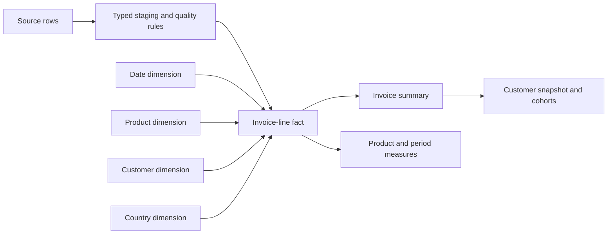

# Client development analytics — design and rationale

Research and design review · 24 October 2026 · **Owner-authorized implementation**

Delivery is tracked as [RA-05/06](../../../docs/backlog/retail-analytics.md).
This document explains the design; the [verification record](../dashboard/README.md)
owns actual test and native-workbook acceptance results.

**Decision:** help a retail trading and client-development team explain changes
in purchasing, identify customer groups worth reviewing, and inspect the products
behind those patterns. Connect a finding to a specific business follow-up.

This direction builds on the portfolio owner's experience with sales-associate
systems, customer records, visits and assigned follow-up tasks. The analysis keeps
using real UCI gift-retail transactions; luxury clienteling informs the questions
and presentation, rather than changing the provenance of the records.

## Industry evidence and design implications

Sources were reviewed on 24 October 2026. These are examples of employer practice
and official BI guidance, not a universal operating standard.

| Primary reference | Relevant practice | Application in this case |
|---|---|---|
| [Louis Vuitton: In-Store Clienteling Director](https://www.lvmh.com/en/join-us/our-job-offers/LVM32100) | Review the client portfolio, support retention/reactivation, maintain data quality and turn CRM information into recommendations | Show customer population, observed purchasing and an evidence-backed review priority together |
| [Tiffany: Client Advisor, Montreal Royalmount](https://www.lvmh.com/join-us/our-job-offers/63553) | Capture client information, develop relationships and generate repeat-client business | Emphasize customer coverage and repeat purchasing; connect findings to the owner's sales-associate workflow experience |
| [Tableau: Effective Dashboards](https://help.tableau.com/current/pro/desktop/en-us/dashboards_best_practices.htm) | Design for a defined audience, prioritize the key view, limit views and provide discoverable interactions | One decision per page, two or three main charts, a visible scope and a clear reset |
| [Tableau: Visual Best Practices](https://help.tableau.com/current/blueprint/en-gb/bp_visual_best_practices.htm) | Choose charts for the question; include units, context and a consistent visual hierarchy | Trends use lines, comparisons use bars, cohort activity uses a heatmap; values carry period and population |
| [Tableau: Data Model](https://help.tableau.com/current/pro/desktop/en-us/datasource_datamodel.htm) | Relationships preserve logical tables at their own level of detail | Keep invoice lines, orders and customer/cohort summaries at explicit grains; do not physically join incompatible aggregates |

## What the current data and implementation support

The [source](https://archive.ics.uci.edu/dataset/502/online+retail+ii) supplies
invoice, stock code, description, quantity, timestamp, price, customer ID and
country. These support five analytical perspectives: **time, product, customer,
country and order**. Quantity and price are measures.

The baseline pipeline demonstrates typed staging, missing-ID treatment,
accounting/cancellation classification, sheet-overlap reconciliation, duplicate
sensitivity, distinct-order counting and complete repeat-purchase observation
windows. This increment adds an explicit [dimensional model](model.md), product
diagnostics and native Tableau filter actions. The portable report provides the
GitHub review surface; Tableau interactivity has its own acceptance checks.

A read-only profile of the local database, using the existing `sales` view for
1 December 2009–30 November 2011, returned:

| Profile | Actual result | Design implication |
|---|---:|---|
| Distinct stock codes, trimmed and uppercased | 4,737 | Product analysis has substantial source coverage; this count still includes delivery/service codes |
| Codes with multiple nonblank, trimmed/uppercased descriptions | 598 | Retain original descriptions and choose a documented display label; different descriptions are not automatically errors |
| Invoices containing multiple stock codes | 35,624 of 38,870 | Product-level invoice counts are non-additive across products |
| Countries represented in eligible sales | 43 | Compare market contributions; avoid a map when a sorted bar answers the question more clearly |

The source has no store, advisor, appointment, contact-task, brand/category, cost
or stock-availability fields. Keep these in a future source-mapping specification,
not invented columns in the real analysis. Historical spending is not predicted
lifetime value; a long purchase gap is a review signal, not confirmed churn.

## Minimal model

- **Invoice-line fact:** one selected in-window source row, with sheet/row lineage, invoice
  ID, keys, quantity, unit price, amount and record classification. Invoice ID is
  not a unique line key. Preserve justified repeated rows.
- **Product dimension:** one normalized stock code. Keep a deterministic display
  description (latest nonblank eligible-sale description, with source-row tie
  breaking), the number of description variants and a product/service flag.
  Retain source descriptions in the fact. Do not infer brands or luxury categories.
- **Customer/date/country dimensions:** unique keys and documented attributes.
  Country describes the source transaction's recorded country; do not assume it
  is a customer's permanent location. Unknown customers stay excluded from
  identified-customer measures even if a technical unknown dimension member is used.
- **Invoice summary:** one invoice with its full eligible value, date and resolved
  customer. Verify ownership/date/country consistency before attributing orders. A partially
  missing customer field must not create two orders.
- **Snapshot/cohort models:** derived from orders, with a fixed as-of date and
  documented observation windows. Keep them separate from line-level joins.

Continue with Python, DuckDB SQL and Tableau. The model needs keys, grain,
relationships and reconciliation tests; it does not need another orchestration
platform or a model API.

## Three-page dashboard specification

| Page and audience | Decision and main visuals | Measures and scope |
|---|---|---|
| **01 — Trading performance** · trading manager | Is the change in sales driven by order volume or basket value? Monthly trends and market contribution in Tableau; comparable-period customer bridge in the published analysis | Default Tableau period: January–November 2011. Published comparison: the same months in 2010. Top measures: recorded sales, distinct invoices and average invoice value. Date/country controls apply consistently to the native page |
| **02 — Client development** · customer-development manager | Which customer group deserves investigation, and what evidence supports it? Recency/frequency group bars; first-observed-purchase cohort heatmap; selected-group summary | Fixed snapshot: 1 December 2011. Show identified-customer coverage. Group counts and last-12-month value; 90-day repeat with eligible denominator. Do not silently apply the trading page's date/product filter to this snapshot |
| **03 — Product preferences** · analyst and merchandising partner | What does a selected customer group buy? Product value, order penetration and detail in Tableau; fixed comparable-period value changes in the published analysis | Merchandise-only measures with non-merchandise entries separated. Date/country/customer-group scope is visible. Product selection changes detail without reducing the full-scope penetration denominator |

Each page ends with a concise review item: **finding → evidence → question to
investigate → proposed next action**. For example, the current £650,317 of
last-12-month recorded sales associated with 591 lapsed repeat buyers supports a
review of purchasing cadence and product mix. It is not an estimate of recoverable
sales. No customer contact is performed by the dashboard.

### Calculation contracts for the increment

1. **Order-change bridge:** compare customers purchasing in both periods, only the
   current period, only the prior period, and orders with no resolved customer.
   Current minus prior orders across these mutually exclusive components must
   reconcile to the total change. "Only current period" does not mean newly acquired.
2. **Product value change:** current minus prior merchandise sales by stock code.
   Sum all products to the merchandise total change. A Top N chart includes an
   explicit remainder so its contribution remains interpretable.
3. **Product order penetration:** distinct merchandise invoices containing a
   selected product / all merchandise invoices in the displayed period, market and
   customer-group scope. The denominator is calculated before product selection. Counts across products
   cannot be summed to total orders.
4. **Top 10 product share:** value of the top ten merchandise codes / all merchandise
   value in the displayed period and market. The title states that products, not
   customers, are being ranked. Customer-group selection, if available, is explicit.
5. **Merchandise scope:** separate POST/DOT/C2 delivery, GIFT_0001_* vouchers,
   S samples and TEST001/TEST002 test items before product or units-per-invoice
   analysis. `Service` is the compact export label for these non-merchandise
   records; PADS remains merchandise. Reconcile both parts back to existing
   recorded sales. Preserve the headline definition and the explicit code mapping.
6. **Customer groups and cohorts:** preserve the [current definitions](metrics.md).
   Show the 90-day grouping threshold as a case assumption. Keep month 0 separate
   from the repeat-month colour scale; observed zero and not-yet-observable remain
   distinguishable. Show cohort size alongside percentages.

## Visual direction

Use a restrained client-development review style: warm ivory background, charcoal
text, muted bronze accents and one deep teal analytical series. Keep commercial
meaning in labels as well as colour. Use a readable display heading and consistent
sans-serif/tabular numerals for data; generous spacing and thin gridlines.

- Put a decision-led headline, period, currency and population at the top.
- Use three headline measures and two or three main views per page. Place the key
  finding in the upper-left reading area; move supporting quality details to a
  labelled drill-down or note.
- Keep comparable bars on a common zero baseline. Show enough precision to compare
  values without filling cards with decimals. Show the sample size with rates.
- Avoid decorative maps, 3D charts and brand logos. Large photographs should not
  displace analysis. This is an operational review, not a storefront.
- Include actual filter actions, selection feedback and reset. A tab switch alone
  is navigation, not analytical interactivity. Keep interactions keyboard-accessible.
- Design for a normal laptop viewport first, then check labels, contrast and the
  narrow layout. Screenshots and the workbook should share the same metric labels.

## Implementation order and acceptance

1. **Model and product quality:** create the fact/dimension contracts, profile
   description variants and service codes, and test join cardinality. Every
   dimension join preserves fact-row counts and amounts.
2. **One diagnostic analysis:** explain the observed order decline through the
   customer bridge and inspect associated product changes. Reconcile both bridges;
   present possible explanations separately from arithmetic contributions.
3. **Tableau and presentation:** implement the three pages, verify native opening
   and refresh, and exercise date/country/product selections and reset. Compare
   representative filtered values directly with SQL before refreshing screenshots.

Review with three concrete tasks: explain the sales/order divergence; investigate
the 591-customer group; identify products contributing most to the comparable-period
value change. Record what the reviewer found, the scope used and any ambiguous
label. This checks decision usefulness alongside arithmetic correctness.

The fixed January–November change diagnostics and the native workbook's selectable
periods have separate visible scopes. A fixed all-market comparison must not appear
to respond to a country filter. Native rendering, actions, reset and refresh are
verified against those stated scopes before they are marked accepted.
