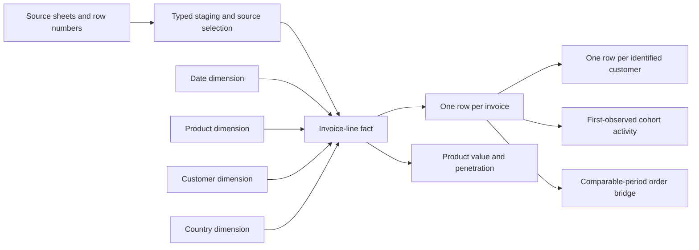

# Retail analytical model

**Purpose:** make sales, invoice, product and customer questions reusable without
changing their meaning when a reviewer filters or combines data. This is the
RA-05/06 model contract; [metrics](metrics.md) owns business definitions and
[verification](../dashboard/README.md) records executed checks.

## Grains and relationships

| Structure | Grain and key | Main use |
|---|---|---|
| `fact_invoice_line` | One selected in-window source row; source sheet + original row number | Amount, quantity, classification and lineage |
| `dim_date` | One date in the complete 730-day analysis calendar | Consistent year/month/date slicing, including days without transactions |
| `dim_product` | One normalized stock code | Stable display name, description-variant count and merchandise/service classification |
| `dim_customer` | One identified customer key | Relate known customers without combining unknown shoppers |
| `dim_country` | One normalized source country | Attribute a transaction to its recorded country |
| `fact_invoice` | One eligible sales invoice key | Distinct-order counts, customer attribution and whole-invoice value |
| Customer snapshot | One identified customer at 1 December 2011 | Recency, last-12-month frequency/value and transparent groups |
| Cohort activity | Cohort month × month index, optionally × snapshot group | Monthly purchasing with an eligible observation period |

Each dimension has a unique key and a many-to-one relationship from the fact.
Country stays an attribute of the transaction's recorded context, rather than an
assumed permanent customer location. Invoice IDs are order keys, not line keys.
Exact repeated source lines retain their separate lineage.

## Product and invoice decisions

Normalize stock codes with trimming and uppercase. Choose the latest nonblank
eligible-sale description for display, breaking timestamp ties with source-sheet
and row order. Preserve source descriptions and count normalized variants; a
variant can be a legitimate change rather than an error. Do not infer brands or
merchandise categories from a product name.

Non-merchandise codes are separated before product analysis: POST/DOT/C2 delivery,
GIFT_0001_* vouchers, S samples and TEST001/TEST002 test items. `Service` is the
compact Tableau label for this group; PADS remains merchandise. This explicit
case mapping is inspectable in SQL, rather than a guessed category taxonomy.
Recorded sales retains these eligible amounts under the established definition.
Reconcile the two parts so a merchandise chart does not silently redefine total sales.

An invoice with a sole known customer and other lines missing the ID can inherit
that customer in the invoice-level model. Keep the original line-level ID for
source-quality measures. Multiple different known IDs on one invoice are a
validation failure, as are multiple transaction dates or countries for a sales
invoice. An invoice with no known ID contributes sales and order counts,
but never becomes one synthetic customer shared with other unknown shoppers.

## Tableau delivery model

The dimensional model is built locally in DuckDB using `03_model.sql`; diagnostic
marts follow in `04_diagnostics.sql`. Tableau consumes purpose-built
flat exports at two explicit grains: eligible sales lines and customer snapshots.
This keeps a small workbook straightforward while preserving a traceable warehouse
model. The two grains are not joined into one table.

| Local export | Grain | Analytical treatment |
|---|---|---|
| `data/processed/tableau_sales.csv` | Eligible sales line | Sum value; count distinct invoice; merchandise/service filter is explicit |
| `data/processed/tableau_customers.csv` | Identified customer at the fixed snapshot | Count customers once; aggregate frequency/value or eligibility counts |

`results/cohorts_by_segment.csv` is an aggregate at cohort month × month index ×
snapshot group. Aggregate rates as **sum(active customers) / sum(cohort customers)**
within the same cohort month/index. Do not average group percentages or sum a
cohort denominator across different month indices.

`results/order_bridge.csv` holds the comparable-period customer components.
`results/product_changes.csv` holds product-level January–November comparisons.
Its counts describe invoices containing each product and are not additive across
products. `results/product_preferences.csv` shows the top 20 merchandise products
within each customer group; the visible rows are a ranked subset, not the full
group total. Row-level exports and customer records remain local; public files contain
aggregate analysis and the workbook definition.

## Controls and change impact

- Dimension joins preserve fact counts and Decimal amounts.
- Invoice-level attribution is checked before customer bridges or group analysis.
- Merchandise plus retained service amounts reconcile to recorded sales.
- Customer bridge components reconcile to the full comparable-period order change.
- Product value contributions reconcile to the merchandise change; order
  penetration uses all relevant merchandise invoices as its denominator.
- The customer snapshot and cohort definitions are fixed unless a change explicitly
  rebuilds them. Trading-page date filters do not redefine the customer's group.

The new structure extends the analysis without changing existing sales, cancellation
or repeat-purchase definitions. [A7–A13](../../../docs/backlog/retail-analytics.md#acceptance-cases)
connect these contracts to model, diagnostic and native-workbook acceptance.
