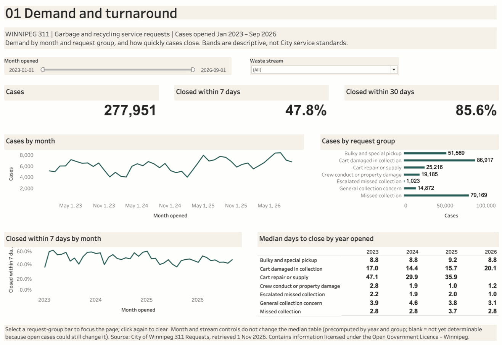
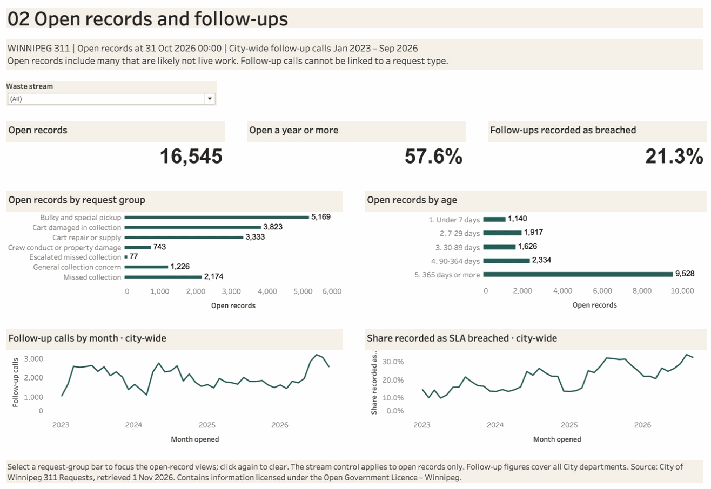

# Winnipeg 311 Service Operations

> **Scenario (simulated):** Winnipeg's 311 contact centre and the Water and Waste
> department review residential garbage and recycling service requests: what drives
> demand, how long requests take to close, and whether the open queue is live work.

**Status:** complete (1 November 2026): reconciled extract, SQL model, findings,
an improvement plan and a two-page Tableau workbook checked natively against SQL. Source: the City of
Winnipeg's public [311 Requests dataset](data/README.md); the stakeholders and
review are simulated.

| Demand and turnaround | Open records and follow-ups |
|---|---|
|  |  |

[Dashboard guide](dashboard/README.md) · [native check](dashboard/verification.md)

## Conclusions and what to improve

| Conclusion (measured) | Proposed improvement (not tested) |
|---|---|
| 63% of cases report a collection that went wrong: missed pickups, crew-damaged carts (84,457 alone) or crew complaints | Pilot cart-damage prevention on selected routes; measure reports per 1,000 households |
| Missed collections slow down in summer: 89–90% closed within a week in 2023–24, 59% in 2025 and 77% in 2026, while 2026's other months reached 93%. Fewer reports in 2025 did not mean faster closing | Plan summer 2027 recovery from an internal review; target the 2023–24 level, which would have meant about 770 fewer residents waiting over a week in summer 2026 |
| 58% of open records are a year old or more, so the open count is not a backlog | Sample-check and close finished records; agree a closure rule before setting open-work targets |
| Chasing cannot be attributed: follow-up calls are not linked to the original case | Change request with acceptance criteria to record follow-ups against the case |

Owners, timing, baselines, requirements and risks:
[conclusions and improvement plan](docs/02_conclusions_and_improvements.md).

## Questions and answers

| Question | What the data shows |
|---|---|
| What drives demand? | 277,951 cases from January 2023 to September 2026. Damaged carts (31%) and missed collections (29%) lead; May–July runs 42% above winter. January–September 2026 is 7.9% above 2025. |
| How long do requests take? | Median 2.8–3.7 days for missed collections, about 9 for bulky pickup, 14–20 for damaged carts and 30–47 for cart repair. Missed collections closed within a week dropped to 74% in 2025 before recovering. |
| Is the open queue live work? | Probably not all of it: 58% of the 16,545 open records are a year old or more, including 1,799 missed-collection records open 90+ days. |
| How much do residents chase? | City-wide follow-up calls fell 19% from 2023 to 2025 while the share recorded as SLA breached rose from 15% to 25%. These calls cannot be linked to request types. |

Full results and caveats: [findings](docs/findings.md).

## What this case demonstrates

- **Business analysis:** requirements and acceptance criteria for a simulated
  municipal service review ([requirements](docs/01_business_requirements.md)); a
  prioritized improvement plan with baselines, proposed targets and a change request
  ([plan](docs/02_conclusions_and_improvements.md)); stated questions for the records
  owner instead of unsupported conclusions.
- **Data work:** a reproducible API extract with row-count reconciliation by type,
  interaction-to-case modelling, a request-type map across a March 2025 rename, and
  a censoring rule so still-open cases cannot distort turnaround
  ([model and metrics](docs/metrics.md)).
- **BI:** a generated two-page Tableau workbook with weighted rates, cross-source
  selection and non-additive medians kept precomputed ([dashboard](dashboard/README.md)).
- **Testing:** regression tests for deduplication, snapshot status, scope and
  censored quantiles ([model tests](tests/test_service_model.py)), improvement
  baselines ([baseline tests](tests/test_service_improvements.py)), workbook structure
  tests ([Tableau tests](tests/test_service_tableau.py)), build checks in
  [checks.json](results/checks.json) and a [native filter check](dashboard/verification.md).

## Limits

- No current public service standard per request type was found, so no case is
  called late. 1/3/7/14/30-day bands are descriptive.
- The analysis cannot assess crews, contractors, staffing, cost or savings.
- Ward is incomplete from 2024 (about 70%), so geography is not a headline.
- The source updates daily; published results describe the recorded snapshot.

## Files

| Path | Contents |
|---|---|
| [scripts/extract_requests.py](scripts/extract_requests.py) | SoQL extract, API control counts, manifest |
| [sql/](sql/) | Staging, case model and marts (DuckDB) |
| [scripts/build_analysis.py](scripts/build_analysis.py) | Build, reconciliation checks, aggregate export |
| [reference/request_type_map.csv](reference/request_type_map.csv) | 63 request types → seven groups |
| [scripts/build_improvement_baselines.py](scripts/build_improvement_baselines.py) | Improvement baselines from the published results |
| [reference/demand_type_map.csv](reference/demand_type_map.csv) | Request types → collection failure or other request |
| [scripts/build_tableau.py](scripts/build_tableau.py) | Generates the Tableau workbook from the results |
| [dashboard/](dashboard/) | Workbook, screenshots and native verification |
| [results/](results/) | Published aggregates only; no request records |
