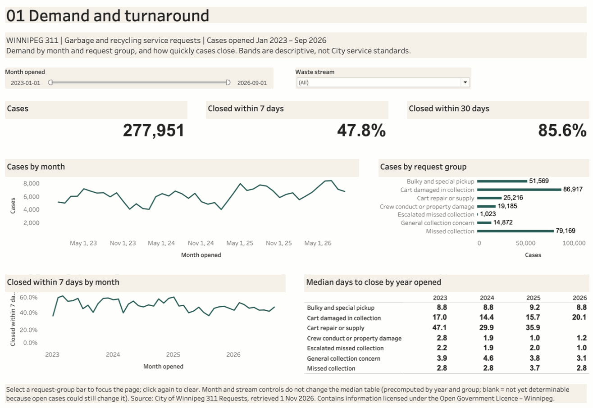
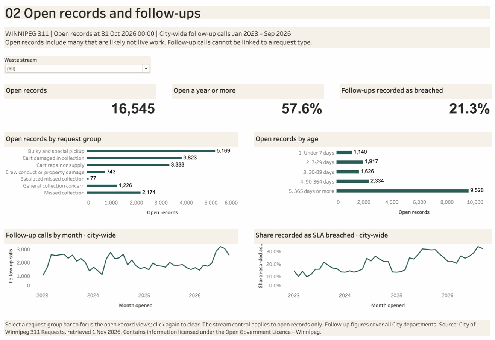

# Service Operations Dashboard — Tableau

**Status:** two-page [workbook](service_operations.twb) checked natively in Tableau
Desktop on 1 November 2026: filters, request-group selections, an empty selection
and reset match SQL over the published results ([verification](verification.md)).

| 01 Demand and turnaround | 02 Open records and follow-ups |
|---|---|
|  |  |

## Open it

1. Run the [build](../data/README.md#reproduce) or use the committed `../results` CSVs.
2. Open `service_operations.twb` in Tableau Desktop. Its four text connections point
   to `../results/*.csv` relative to the workbook. No data is bundled.
3. Regenerate the workbook after changing the layout with
   `python projects/winnipeg-311-service-operations/scripts/build_tableau.py`.

## What each page answers

| Page | Views | Controls |
|---|---|---|
| 01 Demand and turnaround | Cases; share closed within 7 and 30 days; cases by month; cases by request group; monthly 7-day share; median days by year opened | Month range and waste stream (monthly views); select a group bar to focus the page, including the median table |
| 02 Open records and follow-ups | Open records at the snapshot; share open a year or more; open records by group and age; city-wide follow-up calls and the share recorded as SLA breached | Waste stream (open records); select a group bar to focus the open-record views |

Shares are computed from summed counts, so they stay correct under any filter.
Medians are not additive: the median table comes precomputed from
`turnaround_by_year.csv` and responds only to group selection. Blank cells are not
yet determinable ([censoring rule](../docs/metrics.md#measures)).

Bands such as "closed within 7 days" are descriptive, not City service standards.
Follow-up calls cover all City departments and cannot be linked to a request type.

Data: City of Winnipeg 311 Requests, retrieved 1 November 2026. Contains information
licensed under the Open Government Licence – Winnipeg.
